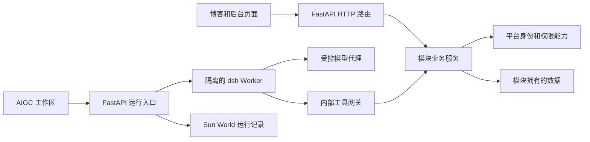

# Sun World 全栈业务模块与 Agent 插件架构

日期：2026-11-10。状态：Astra 独立设计审查已完成。P0 本地模拟协议链路通过，真实模型复测待执行。

## 架构决策

Sun World 采用按业务划分的模块化单体。一个模块可以在现有 React、FastAPI 和数据存储中拥有自己的实现，并向 Agent 注册工具和 Skill。各端以同一模块 ID 和业务契约对应，各自沿用当前仓库的目录和构建方式。模块随代码审查和版本发布安装，首版采用静态注册，运行期开关控制暴露范围。

FastAPI 是业务执行和授权的最终入口。dsh 是可替换的 Agent 运行时，负责模型、工具和上下文的编排。React 保留博客、后台和 AIGC 的页面入口，按公开契约渲染。采用这套架构可以先独立交付博客内容问答，再逐步开放创作和运营能力。



## 模块契约

| 组成 | 归属和约定 | `blog-content` 示例 |
| --- | --- | --- |
| 前端 | `apps/web/src/modules/<feature>/`，沿用 `AppModule` 与 `modules/registry.ts` 注册路由和导航 | 复用 `blog` 和 `home` 模块已有页面与 SEO |
| 后端 | `apps/api/src/modules/<feature>/`，依次为路由或工具适配、应用服务、仓储。对外提供类型化命令和查询 | 在既有 `BlogManager` 之上抽出公开读取服务，网页路由和工具复用 |
| 数据 | 模块声明表、索引或集合的所有权，部署迁移入口集中执行 | 首期沿用 MySQL 文章元数据和 MongoDB 正文，按实际查询计划决定是否补索引 |
| 接口 | 现有 `packages/contracts` 维护 HTTP、公开 SSE 类型和版本。后端维护规范化工具输入、输出和授权策略 | `blog.search_public`、`blog.read_public` |
| Agent | 工具适配器和受版本控制的 Skill 归模块所有。Worker 仅安装审查过的 dsh 组合和工具适配器 | `blog-qa` Skill 指导检索、核对来源和引用 |

模块注册记录最少包含 `id`、依赖、权限键、公开入口和工具声明。工具声明包含稳定 ID、版本、输入输出 schema、所需权限、数据分类、读写类别、确认策略。FastAPI 的工具注册表是执行清单的权威来源，Worker 消费同一份构建产物或版本化投影。首期用显式注册清单、现有 Web 路由组装和 FastAPI 路由列表，不引入跨语言插件管理器。CI 检查重复 ID、重复路由、依赖环、缺失权限和 schema 漂移。模块依赖平台公开接口，跨模块业务读取走目标模块服务，跨模块数据变更由数据所有者执行。

工具执行类型化业务操作。Skill 是供模型阅读的 Markdown 流程说明，可以引用工具 ID。dsh 插件负责装配工具和 Skill。角色、功能开关、工具是否可见及能否执行均由平台策略计算。用户自定义提示词只能影响模型上下文。

一个模块可拥有网页、API 和 Agent 三类入口。生产开关优先控制 Agent 工具暴露和调用，网页可继续提供原有功能。下线顺序为停止接收新任务、撤销工具执行许可、处理运行中的任务、隐藏入口。历史记录按模块和工具版本展示，数据清理另走迁移流程。

## 公共能力和授权

平台提供身份与会话、权限判断、审计、限流和配置。业务模块声明能力并实现资源级校验。先复用现有登录、管理员判定和 AIGC Redis 配额。在草稿模块上线前定义作者和审核者的角色映射，保留现有管理接口的授权语义，分别验证新增接口的资源范围。

现有 `AuthManager` 和 `identity` 模块承担会话与身份绑定。`roles`、`resources`、`user_roles`、`role_resources` 已表达角色和资源关联，当前文章写入等入口主要依赖 `require_admin`。认证中心和权限中心先作为 FastAPI 内部公共服务演进：

| 公共服务 | 首版实现 |
| --- | --- |
| 认证中心 | 统一解析匿名、登录用户和内部服务主体。沿用现有 Cookie、Redis 活跃会话、账号状态和近期认证能力，向业务提供稳定的用户 ID 和会话引用。Worker 身份和用户授权分别验证。 |
| 权限中心 | 模块在代码中声明稳定能力键。通过现有角色关联或兼容的新增映射授予能力。后端每次执行时按当前授权判断能力，模块服务再校验归属、可见性及资源状态。未知能力默认拒绝。 |
| 管理后台 | 逐步展示角色、已登记能力及授权来源。授权变更要求具备对应的管理权限和近期认证，防止越权授予，保留管理员恢复路径并审计。 |

接入顺序为给新增入口登记能力，建立管理员等既有角色的基线映射，再逐个迁移旧入口。过渡时比较新旧决策并解释差异。启用新决策后，避免因缓存或 Worker 的运行快照而接受已撤销权限。首批验收覆盖同一资源从网页和 Agent 访问、注销和角色撤销、跨账号访问，以及授权管理的权限提升边界。公开说明见[架构笔记 01](../blog/2026-11-10-agent-platform-identity-and-permissions.md)。

- 浏览器请求从现有登录会话得到主体。Agent 运行入口保存服务端生成的 `run_id`、主体引用、会话归属、允许工具集合、版本和到期时间。试点仅允许指定登录账户发起；访客仍使用现有 AIGC 路径。
- Worker 通过私网身份调用内部工具网关，另带绑定到单个 run、受众和时效的不可猜测凭证。模型只提供工具参数。网关从服务端记录恢复主体，检查调用身份、run 状态和允许范围，再执行实时权限及资源校验。取消、到期和权限撤销后的新调用一律拒绝。
- 工具参数按 schema 严格校验。限制查询长度、结果条数、返回字节和正文长度。数据库执行、序列化及向模型传输前分别做必要的数据范围限制。检索内容、用户输入和 Skill 不能授予权限。工具输出只包含执行所需字段。
- 操作权限按 `blog.article.read_public`、`blog.draft.write_own`、`blog.article.publish` 等业务能力定义。工具可见性用于提示，业务服务在每次操作时重新校验。网页、Agent 和将来的定时入口共享同一业务规则。
- 写操作单独分期。草稿创建使用服务端幂等键和作者范围。发布由页面展示目标、动作和版本，用户确认后，由服务端签发绑定到主体、操作、目标、规范化参数摘要、预期版本及有效期的一次性确认记录。执行时再次鉴权和比对版本。确认消费与可事务化写入、幂等结果同事务完成。权限变更、目标变化或确认过期要求重新确认。
- 记录 `run_id`、调用 ID、主体引用、工具版本、结果状态、错误码和耗时。访问、留存和删除策略跟随数据分类。应用日志不写凭据、原始工具参数和完整工具结果。结构化引用由网关结果派生，由前端按既有内容安全规则渲染。

## dsh 接入与运行边界

第一选择是固定版本的官方 SDK 加 Sun World 自定义 profile，通过私有 Worker 服务调用，SDK 在 Worker 内使用 stdio 驱动子进程。dsh 在 Cordis 中注册模型、工具和会话等插件。Python SDK 的默认运行时也会启动 dsh 子进程。官方 `sdk-minimal` 仍包含本地执行能力，官方文档还描述了会话日志随请求上传的默认配置。因此原型从显式允许清单组装 profile，并验证最终生效的注册表和实际出站流量。参考 [官方架构](https://github.com/deepseek-ai/deepseek-harness/blob/master/docs/architecture.zh.md)、[Python SDK 指南](https://github.com/deepseek-ai/deepseek-harness/blob/master/docs/user/guide/python-sdk.md)、[工具注册](https://github.com/deepseek-ai/deepseek-harness/blob/master/packages/core/tools/README.md) 和 [上游安全说明](https://github.com/deepseek-ai/deepseek-harness/blob/master/SAFETY.zh.md)。

- profile 只装载运行循环、提示词、最小会话能力、SDK JSON-RPC 服务、模型代理和当前批准工具。用户输入通过 SDK 的纯提示词入口提交，避免以原生命令解释斜杠开头的提问。P0 验证该入口的事件关联、取消和 Skill 行为。显式关闭或移除终端、通用文件访问、浏览器、任意网络工具、外部 MCP、子 Agent、热安装、本地指令发现和会话日志上传。使用应用级固定 Skill，避免运行时发现或安装用户内容。
- Worker 以非 root 身份在独立容器或测试环境运行，限定 CPU、内存、进程数和临时工作空间。出站仅允许内部工具网关和模型代理。禁止宿主目录、Docker socket、业务数据库和生产密钥访问。首期使用隔离测试数据。通过 Worker 验证的自定义 profile 才可考虑内测。
- 模型代理由服务端管理凭据和地址，沿用现有模型目录、外联地址策略、限额和超时。现有 Provider 接口只输出文本 delta，需要在代理适配中验证工具调用 schema、流式工具参数、停止原因和 usage。试点仅选一个已测工具调用的模型，设每次运行的步骤、工具次数、请求时间、总 token 和并发上限。模型代理也验证运行凭证、模型选择及预算，拒绝用户指定外部地址和凭据。上下文压缩等额外模型请求同样纳入预算。
- P0 和 P1 每次运行启动独立 SDK 子进程，使用独立临时 `DSH_HOME`、会话与工作目录。凭据通过最小范围注入。Worker 外层设置总时限，超时先撤销运行权限，再限时关闭 SDK 并终止子进程，最后回收临时目录。SDK 的请求超时只限制协议响应等待，无法替代总时限。启动时只清理已确认没有活跃进程的遗留目录。P1 固定为单轮独立问答。跨轮历史按角色投影、复用进程和恢复 dsh 会话分别验证后再启用。
- SDK 版本、Worker 镜像、插件依赖和 profile 固定版本，升级重复跑协议、隔离和数据外联验证。上游标注为开发者预览。若最小 profile、结构化工具调用或隔离能力无法验证，则保留试点开关关闭，业务模块和工具契约可用于替换适配器。

## 运行、会话和界面协议

FastAPI 为业务状态和用户历史的权威来源。dsh 内部会话是单次执行状态。P1 在 AIGC 工作区提供单独的「博客问答」入口，使用独立会话。首个提问请求携带客户端生成的幂等键。接口路径和字段以 OpenAPI 为准，设计如下：

| 入口 | 契约 |
| --- | --- |
| `POST /ai/v1/blog-qa/runs/stream` | 接收问题与幂等键，按 V1 SSE 返回运行状态和最终答案。同一主体同一键的重复请求返回 HTTP 409 JSON 和既有 run ID，参数变更返回独立冲突码 |
| `GET /ai/v1/blog-qa/runs/{run_id}` | 仅归属账户可读取状态、关联会话及最终消息引用，用于刷新、断线和重复提交后的状态恢复 |
| `POST /ai/v1/blog-qa/runs/{run_id}/cancel` | 仅归属账户可停止运行，重复调用返回当前状态，停止请求受现有会话与 CSRF 策略约束 |

页面从 `run.started.data.run_id` 或重复请求响应取得 run ID。新入口沿用 V1 事件类型，并只对该入口扩展 `data` 字段。工具过程进入内部运行记录。普通聊天及历史编辑入口不接收博客问答会话，避免不同引擎读写同一条历史。单轮期间仅提交本次问题给模型，不使用其他聊天、用户自定义 Skill 或私有模型配置。

```text
accepted → running → completed | failed | cancelled | interrupted
```

- 接收时持久化 `run_id`、主体、会话、幂等键和请求摘要、引擎、版本、执行代次及到期时间。创建会话、用户消息和运行记录用同一 MySQL 事务。Redis 负责准入和限额。工具调用与模型代理只接受处于 `running`、未到期且代次匹配的请求。终态写入按代次和当前状态做条件更新。完成与取消竞争时，第一个提交的终态生效，后到的写入读取该终态。
- V1 事件由 FastAPI 连续编号，`run.started` 后只投影一条最终答案。P1 等 dsh 明确成功结束且最终答案通过校验，发送含文本和服务端引用块的 `message.completed`。中间模型文本留在运行时，只有根会话本次提问对应的 `turn/end` 结束原因为 `completed` 才允许提交。`max-tokens`、`error`、缺失或未知原因、协议异常和输出校验失败均映射为 `failed`。超时映射为 `failed`，用户停止或流断开映射为 `cancelled`，Worker 丢失且超过租约期限映射为 `interrupted`。取消或中断时，连接仍存活则使用同一事件类型携带专用错误码，刷新从状态接口恢复。流断开后不补发中间事件。
- 完成事务在同一连接锁定运行和会话归属，写入最终消息、引用及 `completed`，提交后发送终止事件。存储暂时不可用时，流报告保存失败，后台对账在存储恢复后补记中断。失效的 Worker 回调无法提交结果。主动停止或客户端断开时撤销运行授权并给 Worker 限时清理。进程异常退出后由对账任务关闭超时的运行，重试由用户发起。
- P0 初始预算为最多 4 次模型调用、4 次只读工具调用、45 秒总时限和并发 1。结合真实模型、冷启动及内存数据校准。Worker 不可用时，问答入口显示明确错误。普通聊天继续走现有路径。

## 数据和发布

保留现有 MySQL、MongoDB 和 Redis 的职责。现有文章元数据与正文跨库，首期读取能力按两端同时存在且可公开才返回。遇到缺失正文、遗留孤儿、删除中的记录均降级为无结果。先核对当前 `BlogManager` 的阅读计数、缓存和可见性，再抽出供工具与公开 HTTP 共用的查询逻辑，网页适配器单独保留既有统计副作用。搜索先用 MySQL 返回有界候选，再批量核对 MongoDB 中正文是否存在，避免逐篇跨库请求。首期工具返回标题、摘要或有界正文片段和 ID。模型输出纯文本答案及引用 ID。FastAPI 校验这些 ID 属于本次实际提供给模型的来源集合，再检查公开可见性并按站点路由生成链接。站内来源以服务端生成的 `link` 块展示。没有来源时明确返回未找到相关公开文章。工具正文视为资料输入，不拼入系统提示词。

首期运行持久化如需 DDL，先在 `apps/api/src/database/mysql/schema_migration.py` 现有部署契约内做兼容性新增。模块拥有数据结构和变更说明，平台提供统一执行入口。后续有跨模块独立迁移需求时，再引入模块 ID、迁移序号、校验和、执行锁和断点检查。MySQL DDL 按可能隐式提交处理，部署前后检查真实 schema，部分成功先对账再重跑。功能启用和迁移分开，旧 API 在新增 schema 上保持兼容。回滚先关开关或切回旧版本，新增数据结构留存。破坏性收缩单独评审、备份和发布。

草稿使用独立 MySQL 表，`owner_user_id` 由服务端从当前账户赋值，客户端参数和显示名无法指定所有者。现有文章的 `author` 字符串仅作展示。保存草稿使用单库事务、版本条件和幂等键。发布跨 MySQL 和 MongoDB，单独设上线门槛：

1. 先扩展 schema，建立独立 MongoDB 版本集合，以 `(blogId, version)` 建唯一约束，回填旧文章基线。旧集合继续服务迁移前路径。切换窗口停写并重做增量对账，旧正文保留到退役窗口结束。
2. 让公开 HTTP、网页/SSG 的数据入口和 Agent 工具全部按公开版本指针读。现有管理写入口改走版本化发布服务或在切换期间停写。以写入和读回测试确认旧的按 `blogId` 原地写入路径已退出。
3. 确认、幂等记录、目标版本和 outbox 在一笔 MySQL 事务中提交。消费者以确定性版本写入并校验 MongoDB，再按预期旧版本条件切换 MySQL 指针。对账可恢复处理中断，发布失败时上一公开版本仍可读取。
4. 切换后仅回滚到能理解版本指针且兼容现存数据的最低 API 版本。紧急处理先关写开关，暂停并对账 outbox。恢复单篇内容走受控版本切换。发布前演练新旧读写、半完成任务和回滚。

部署顺序为兼容性数据扩展、API 和私有 Worker、带能力探测的 Web 入口、账户白名单。发布分别检查 Worker 健康和现有博客健康。保留现有首页、文章路由、SSG、canonical、ICP 和 AIGC 回归用例。项目记录的 Lighthouse 规格为 2 核约 2 GB，原型在本地或隔离环境跑，生产部署位置由 CPU、内存、延迟和成本数据决定。

## 实施顺序和验收

| 阶段 | 交付 | 完成条件 |
| --- | --- | --- |
| P0 协议原型 | 独立环境固定 SDK 版本，用模拟模型和固定文章验证自定义 profile、工具回调、会话事件和取消，再用一个批准的真实模型复测 | 两次模型请求间准确传回工具结果，模型与工具出站受限，无法注册或调用未批准工具。覆盖连续不同账户的 home/进程隔离、总时限后的进程回收、斜杠开头提问和终态映射，记录冷启动与峰值内存 |
| P1 内容内测 | 现有 AIGC 入口下按账户启用「博客问答」，注册搜索及正文读取工具、引用验证和运行记录 | 问答能附真实站内来源，缺正文、无结果、伪造引用、取消、超时、旧执行代次和跨账户访问均有覆盖，普通聊天兼容 |
| P2 创作 | 作者工作台接入大纲、草稿建议和受限的草稿保存 | 覆盖跨账户读改删、伪造所有者参数、幂等、并发版本控制和审计。发布能力等跨库一致性和确认流程验收后单独开放 |
| P3 扩展 | 评论摘要和回复建议、运营只读统计，再评估独立模块及经审查的 MCP 工具 | 逐模块验证数据范围、脱敏、写入确认、失败与回滚，验证额外负载不影响博客公开读链路 |

原型和内测须分别验证工具路径与网页路径的授权一致性、模型输入与日志数据范围、进程和网络隔离、源链接真实性、SSE 向后兼容、重复请求与取消、Worker/Redis/MySQL 不可用、迁移部分成功和回滚。P0 记录实际协议样例和资源数字，再决定生产预算与部署容量。设计通过仅代表可以启动受控原型。

当前工作树已有 AI 运营和评论变更，后续实施时先盘点现有差异和契约归属。本文提出的目录、权限键和预算均为设计约定，最终路径随首个模块的实现落地。

## Astra 独立审查结论

Astra 核对了当前博客管理器、AIGC 流协议和官方 SDK。可开展 P0。P1 以内测原型结果为准，重点验证进程和 `DSH_HOME` 隔离，以及 SDK 终态到 V1 SSE 的转换。P2 草稿按账户 ID 归属。发布在旧读写迁移、版本一致性和最低回滚版本验证完成前不启用。以上四项均已纳入对应设计与验收条件。SDK 行为参考 [官方 SDK 说明](https://github.com/deepseek-ai/deepseek-harness/blob/master/python/sdk/README.md#results-and-notifications)。

## 2026-11-10 P0 本地协议结果

[复跑说明](../../tools/dsh-blog-p0/README.md)使用 dsh 0.2.2-rc.1、真实 SDK 子进程、固定文章和本地模拟 Messages 服务。九个场景通过。主链路发出三次模型请求，实际执行搜索和读取，再根据网关记录生成引用。外部网络和仓库文件读取探测由 macOS 沙箱拒绝。示例运行的 SDK 初始化耗时约 0.60–0.98 秒，九个场景合计 7.86 秒，`time -l` 报告最大常驻内存约 136 MiB。这是单机样本，未包括依赖安装。

真实模型自主选工具、实际站内文章和 V1 SSE 接入仍待后续验证。P0 没有接入线上博客数据或修改线上部署。[架构笔记 02](../blog/2026-11-10-dsh-readonly-blog-qa-p0.md)记录了读者版过程和图示。
