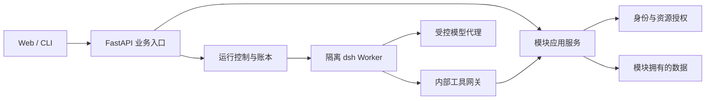

# Sun World 模块化平台与 DSH 架构总纲

更新：2026-11-12。状态：设计收敛，暂不开发。已有成果限于本地 P0 协议原型；以下目标设计不代表已部署能力。本轮没有调用真实模型或重新验证 P0。

## 阅读入口与文档职责

| 要回答的问题 | 权威文档 |
| --- | --- |
| 统一登录、委托、租户/资源隔离如何验收 | [身份与隔离规范](federated-identity-and-isolation.md)及[专项评审](../reviews/2026-11-12-federation-security-review.md) |
| Stars 首页与全部项目如何分期对接 | [全项目接入方案](project-federation-plan.md)与[项目台账](../product/project-integration-inventory.md) |
| 为什么采用这些边界、目前到哪里 | 本总纲；生产事实另见 [current-state](../current-state.md) |
| 文件如何命名、缩进、测试放哪里 | [文件、格式与测试规范](../repository-conventions.md) |
| 模块如何鉴权、插入页面、接入其他项目 | [模块与扩展契约](module-extension-contract.md) |
| 后端目录、工具、Skill、运行及发布怎么设计 | [DSH 实现规范](dsh-implementation-standard.md) |
| 哪些问题有源码依据 | [评审报告](../reviews/2026-11-12-dsh-architecture-review.md) |
| 将来按什么顺序实施、怎样验收 | [实施计划](../plans/dsh-platform-implementation.md) |

一个规则只在负责它的文档展开，其他文档引用；接口和数据库名称在实现前仍是设计名称。历史审查与原型结果保留在下方，不作为新规则。规范发生冲突时先修正文档，不能让实现者自行选一个宽松版本。

## 核心选择

采用模块化单体：React 负责页面，FastAPI 负责主体、授权与业务数据，独立 Node/TypeScript Worker 负责 dsh 执行。P1 承接 P0 Node SDK，不同时维护 Python Worker。模块静态注册，Skill 随审查发布；不建设动态插件市场或通用工作流引擎。

网页与工具调用同一业务服务。Worker 服务身份不能代替用户权限，Skill 不能授予能力。开发 Skill、产品 Skill 和用户提示词分别管理。前端以路由、导航、panel/action 扩展点组合模块，后台始终执行资源校验。

其他项目通过稳定包接口或版本化 API/adapter 接入，不共享数据库实现或浏览器 Cookie。跨项目资源必须带明确项目上下文；单项目阶段保留接口，完成隔离迁移前不能启用第二项目。

## 范围与阶段

| 阶段 | 范围 | 状态 / 门槛 |
| --- | --- | --- |
| P0 | 固定文章、模拟模型、SDK 协议与本地隔离 | 有历史验证；真实模型与 Linux 隔离待补 |
| P1 | 指定账户、单轮博客问答、搜索与读取 | 待实施；对应计划 A–D；无发布、个人 Provider、用户 Skill 或任意 MCP |
| P2 | 本人草稿，随后单独开放受控发布 | 计划 E–F；发布等待版本快照、确认、outbox 和回滚演练 |
| P3 | 评论、运营和其他项目接入 | 计划 G；逐模块验证权限、项目隔离和成本 |

P1 保留既有公开博客与普通聊天。跨库发布需要标题、摘要、标签与正文属于同一公开快照；引用验证仅提供来源链路证据，不保证模型理解或持续公开性。详细失败处理只在实现规范维护。

首期保留 MySQL/MongoDB/Redis 及现有部署契约；Worker 是否落在既有小规格服务器，由真实负载与隔离证据决定。目录、测试和门禁均按后续开发任务创建，本轮不建空壳或改配置。

## Astra 独立审查结论

Astra 核对了当前博客管理器、AIGC 流协议和官方 SDK。可开展 P0。P1 以内测原型结果为准，重点验证进程和 `DSH_HOME` 隔离，以及 SDK 终态到 V1 SSE 的转换。P2 草稿按账户 ID 归属。发布在旧读写迁移、版本一致性和最低回滚版本验证完成前不启用。以上四项均已纳入对应设计与验收条件。SDK 行为参考 [官方 SDK 说明](https://github.com/deepseek-ai/deepseek-harness/blob/master/python/sdk/README.md#results-and-notifications)。

## 2026-11-10 P0 本地协议结果

[复跑说明](../../tools/dsh-blog-p0/README.md)使用 dsh 0.2.2-rc.1、真实 SDK 子进程、固定文章和本地模拟 Messages 服务。九个场景通过。主链路发出三次模型请求，实际执行搜索和读取，再根据网关记录生成引用。外部网络和仓库文件读取探测由 macOS 沙箱拒绝。示例运行的 SDK 初始化耗时约 0.60–0.98 秒，九个场景合计 7.86 秒，`time -l` 报告最大常驻内存约 136 MiB。这是单机样本，未包括依赖安装。

真实模型自主选工具、实际站内文章和 V1 SSE 接入仍待后续验证。P0 没有接入线上博客数据或修改线上部署。[架构笔记 02](../blog/2026-11-10-dsh-readonly-blog-qa-p0.md)记录了读者版过程和图示。
