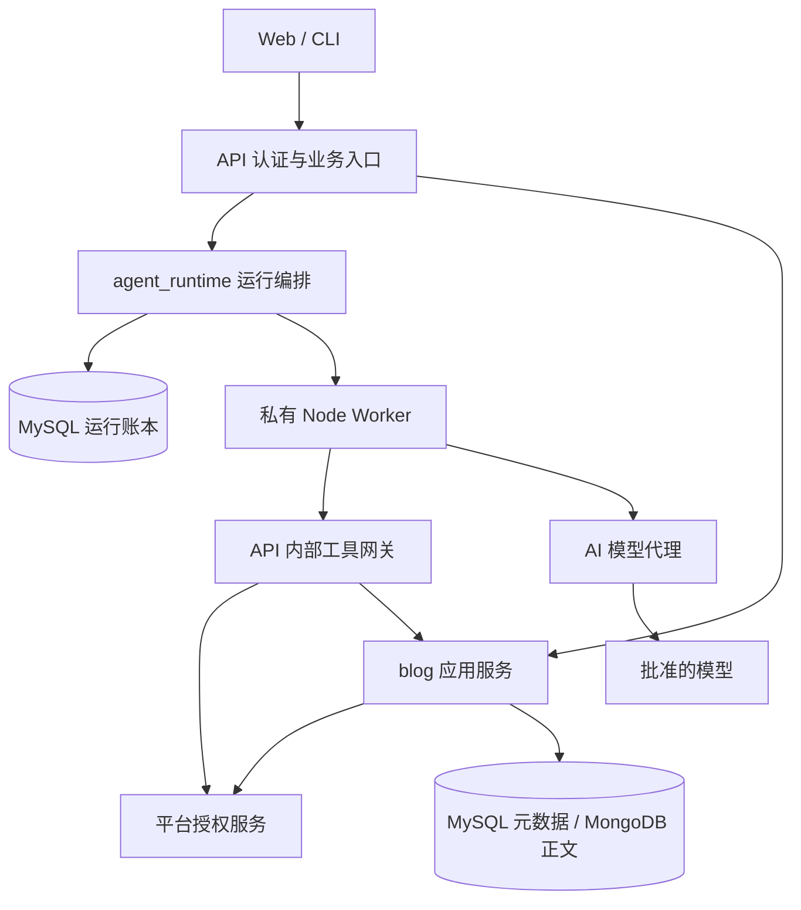

# DSH 平台实现规范与目标仓库架构

日期：2026-11-12；本地实现更新至2026-11-17。状态：设计基线；阶段A基础和B/C本地切片已实现，详见[分支交接](../handoff/branches/zxy-dsh-platform-foundation.md)，仍未整体验收或部署。适用于新增 DSH 能力及触及的旧入口，不要求一次迁移全仓库。依据[评审报告](../reviews/2026-11-12-dsh-architecture-review.md)补充[架构总纲](agent-module-platform.md)；本文收敛首期实现选择，总纲继续定义业务方向。生产状态以 [current-state](../current-state.md) 为准。命名、缩进与测试位置遵循[工程文件规范](../repository-conventions.md)；模块鉴权矩阵、页面扩展点和跨项目适配遵循[扩展契约](module-extension-contract.md)。

## 1. 架构决策与代价

采用模块化单体：Web 组织页面，API 维护业务与授权，独立 Node/TypeScript Worker 运行固定版本 dsh。P1 承接现有 Node SDK 原型；Python SDK 留作替换选项，不并行维护两套 Worker。Worker 仅能访问内部工具网关和模型代理，不直接访问数据库。

| 决策 | 取舍 | 重新评估条件 |
| --- | --- | --- |
| 认证、授权与博客仍在 FastAPI 内 | 避免服务间身份同步和分布式业务事务；共享发布周期 | 团队、负载或合规隔离确需独立部署 |
| 新增私有 Worker 应用 | 多一个镜像与生命周期，但能隔离进程、文件和出站 | Linux 验收失败时更换隔离部署或引擎，不能退回 API 内无隔离执行 |
| 静态模块/工具注册 | 发布时更新能力，换取可追踪依赖与审查 | 有真实第三方插件需求且完成供应链与租户隔离设计 |
| 普通聊天与 Agent 运行分开编排 | 少量协议适配重复，保持旧聊天可用 | 两者稳定后再提取共用执行接口，不先建通用 DAG 引擎 |
| MySQL 运行账本 + Redis 准入 | 增加运行表与对账任务，不引入新的消息基础设施 | 吞吐证明轮询/租约不足，再选择队列；账本仍是权威 |



图为目标职责关系。所有新目录、接口与数据结构均按阶段创建，不生成空壳包伪装已完成。

## 2. 仓库目录及依赖

```text
apps/
  web/src/modules/
    blog/                         # 现有文章页面；通过 API 使用博客服务
    ai/                           # 现有聊天 + blog-qa 数据/事件适配和页面入口
    admin/                        # 能力、运行和模型管理界面
    registry.ts                   # 现有前端路由组装，不替换
  api/src/
    core/
      auth/                       # 新增：Principal、认证适配、Policy 接口
      module_registry.py          # 新增：静态模块组合及校验，不装业务逻辑
    modules/
      blog/                       # 新增，逐步承接 controller/blog_manage.py
        manifest.py               # 模块、能力、工具元数据的权威声明
        public.py                 # 跨模块允许调用的应用接口
        schemas.py                # 业务命令、查询和工具输入输出
        service.py                # 授权、可见性、业务约束
        repository.py             # MySQL/MongoDB 适配，后续按职责拆文件
        router.py                 # 新/旧 HTTP 适配，迁移期仅一个路由拥有者
        tools.py                  # 薄工具适配，调用同一 service
        agent/skills/blog-qa/
          SKILL.md                # 受审查的产品 Skill 原文
          manifest.json           # 版本、工具依赖、hash 和评测集引用
      identity/                   # 保留登录绑定/验证业务；不再建第二套用户体系
      ai/                         # 保留普通聊天、模型目录、凭据、用户 Skill、MCP
        model_proxy.py            # 新增：结构化模型代理，不挤入聊天 stream
      agent_runtime/              # 新增：仅运行协议与控制，不包含博客查询
        router.py                 # 公共 run/status/cancel 与独立内部路由
        schemas.py
        service.py                # 准入、幂等、派发与终态提交
        repository.py             # 运行、调用、来源交付回执和租约条件更新
        gateway.py                # 工具凭证与 schema 检查，派发模块工具
        worker_client.py          # 固定私有地址的有界通信
        reconciler.py             # 租约过期、失联、孤儿运行对账
    database/mysql/schema_migration.py  # 继续集中部署迁移
  agent-worker/                   # 新增私有应用；不发布为 npm SDK
    package.json
    src/
      server.ts                   # 私有派发/取消协议，固定 API 来源
      runtime/dsh.ts              # SDK 唯一依赖入口
      runtime/profile.ts          # 显式插件白名单
      runtime/lifecycle.ts        # home/工作目录/进程组/时限回收
      adapters/tool-gateway.ts    # 只转发审核后的工具调用
      adapters/model-proxy.ts
    tests/                        # 固定协议 fixture 与 Linux 隔离验收
packages/
  contracts/                     # 保留 HTTP/OpenAPI 与 SSE 公开类型
    agent/                       # 新增生成的内部 schema/工具目录/Skill bundle 清单
  cli/                           # 保留本机 CLI；通过 API 接入，不嵌入 Worker
.agents/skills/                    # 开发协作技能，禁止打入 Worker 镜像
tools/dsh-blog-p0/                # 现有实验资产；不是生产启动入口
docs/architecture/               # 决策和实现契约
docs/plans/                      # 分阶段交付与验收
```

`packages/contracts/agent/` 中的 JSON 是语言无关构建产物，Python 不依赖 npm 包。产品 Skill 原文归模块所有，构建时拷贝至 Worker 只读资源目录并验证 hash；禁止再手工维护第二份原文。

依赖规则：

- 路由/工具适配 → 模块应用服务 → 模块仓储；`core` 不导入业务模块。组合根向 registry 显式注册服务，registry 不扫描磁盘或动态安装插件。
- 业务服务依赖授权接口、时钟和仓储接口；事务由应用服务开启，仓储不得悄悄另开连接破坏事务。
- 跨模块只通过 `public.py`，不导入对方 router/repository，不直接写对方表。`agent_runtime` 调用 registry 中的工具 handler，避免依赖具体博客实现。
- `ai` 不反向依赖 `agent_runtime` 的实现：模型代理接收注入的运行授权/预算检查接口；组合根完成绑定。这样避免控制模块与模型模块循环依赖。
- Worker 不导入 API Python 实现或 Web；只依赖生成的契约。共享 UI 包不包含用户鉴权、URL 配置或 dsh SDK。
- Web 模块对外由既有 `index.ts` 暴露；`shared` 不反向引用模块。CLI 平台适配器和个人 MCP 连接不成为默认 Worker 工具。

## 3. 模块与工具声明

稳定业务模块 ID 首期采用 `blog-content`，实际目录为 `blog`，通过 manifest 显式映射；沿用既有 Web 模块 ID `blog`，不为统一命名破坏路由。`identity`、`ai`、`agent-runtime` 各有唯一 owner；`admin` 是管理入口，不是绕开领域服务的数据所有者。

模块至少声明 `id/version/dependencies/capabilities/http_entries/tools/skills/data_owners`。能力键不与菜单 URL 等同，不能把已有 `resources` 行无审核地全量当成操作权限。

工具声明的拟议形状：

```json
{
  "id": "blog.read_public",
  "version": "1",
  "module_id": "blog-content",
  "model_name": "blog_read_public",
  "capability": "blog.article.read_public",
  "effect": "read",
  "data_class": "public",
  "confirmation": "none",
  "input_schema_ref": "BlogReadPublicInput",
  "output_schema_ref": "BlogReadPublicOutput"
}
```

- Pydantic 输入/输出 schema 与 Python manifest 为权威源；生成 JSON Schema、Worker 工具目录和必要 TS 类型。禁止手改生成物。
- `blog.search_public` ↔ `blog_search_public`、`blog.read_public` ↔ `blog_read_public` 使用显式双向映射；审计保存稳定 ID 和版本。模型名只适应上游工具命名约束。
- 输入拒绝未知字段；默认值先规范化再计算幂等摘要。运行身份、租约、模型凭据、owner、API 地址不得放入模型可控制的输入 schema。
- 新增可选字段也要验证消费者兼容；删除字段、改变权限/副作用或解释改变必须升级版本。运行保存精确 manifest/Skill/profile hash；不允许正在运行时换工具版本。
- Worker 启动报告支持的协议版本与 bundle hash；API 只派发匹配组合。版本失配返回不可用，不自动降级到能力更多的 profile。
- 工具可见集合取已安装、模块开关、场景白名单及用户能力的交集；网关调用时再检查，不能把可见性当授权。

## 4. 认证、授权与撤销

`core/auth` 包装现有 Cookie、Redis 会话、账户状态与角色查询，不替换 `AuthManager` 或 identity 的验证/绑定流程。服务端构造不可由请求参数覆盖的 Principal：主体类型、稳定用户 ID、会话 family 引用、近期认证时间、请求关联 ID。Worker 服务主体与被代理用户是两个主体。

每次业务操作的判定顺序：

1. 验证入口身份。浏览器沿用现有 Cookie 与 `core/csrf.py`；P1 run 创建/查询/取消强制登录，不采用普通聊天的可选登录降级。
2. 内部请求验证 Worker 身份（首期独立服务凭据经 TLS，凭据仅外层通信使用），再验证按 run 和 audience 区分的短时随机凭证。数据库只存摘要；模型、提示词、公开响应与日志不得出现凭证。
3. 从账本恢复用户、会话、状态、执行代次、到期时间、工具集合。模型提供的 user/run/role 字段一律不作信任依据。
4. 查询当前会话是否有效、账户状态及当前角色能力；未知能力、状态无法读取、Redis/MySQL 不可用时拒绝 Agent 执行。P1 暂不缓存 allow 结果。
5. 模块服务检查资源归属、公开性、预期版本和确认状态。跨账户对象统一返回不暴露存在性的结果。
6. 提交写入或最终答案前重验运行与资源条件；运行终态写入使用条件更新。已经发送给模型的公开数据无法追回。每次检查拒绝已可见的撤销；Redis 会话与 MySQL 提交之间没有跨库事务，不声称撤销绝对先于所有并发提交。P1 只读接受该检查边界；P2 在敏感写入前须定义数据库授权版本与同事务提交栅栏，未解决不得启用写工具。

角色映射先固定为代码评审的最小基线：匿名可公开读；登录且内测白名单可发起问答；作者仅可操作本人草稿；发布者可发布已确认目标；授权管理员仅在既有可授予范围内变更授权。**P1 仅落地前两项**，不自动给全部登录用户草稿/发布权。现有管理员写权限保持原边界，不用匿名 read 能力推导写权限。

新增工具和公共查询服务从第一天使用统一策略。旧写路由保留 `require_admin` 并逐步迁入同一服务；影子判定只记录差异，不决定放行。每个入口明确切换时点，禁止长期使用“旧判定或新判定任一个通过”。授权变更需近期认证、审计、拒绝自我提权与最后恢复管理员误删；相关后台上线晚于权限内核。

2026-11-17已本地迁移[九项既有管理写服务](../development/admin-management-service.md)：真实access构造当前Principal，实际RC写事务锁定角色目录与操作者账号/绑定后复验，实际commit前再检查Redis和近期时间；保旧HTTP下界、最后管理员和合法自降权。九能力只映射本站既有admin，不从菜单生成grant；没有完整可授予集合、数据库授权版本表或Agent写工具。内部raw持久化兼容路径和Redis检查至MySQL提交的窗口仍在，不能替代上述P2写门槛。

功能开关分为安装、Agent 暴露、运行准入和写入许可。关闭时先停止准入并撤销活跃 run，再回收 Worker；普通网页可按原策略继续服务。工具执行和模型代理都检查实时开关。

## 5. 博客读取、来源与写入

### P1 公开查询

现有博客没有完整发布状态，初始可读谓词明确为：MySQL 元数据存在且 `COALESCE(is_deleted, 0)=0`，MongoDB 对应正文存在。当前没有已验证的迁移隔离字段；若后续引入，需先迁移并纳入统一谓词，不能查询不存在的列。未来增加状态时必须更新同一查询服务；草稿永不写入现有公开表以模拟“未发布”。

`BlogPublicQueryService` 提供有界搜索和读取，由公开 HTTP 与工具共同调用。迁移时先用兼容适配器保留原响应字段、排序、分页语义与错误码；原路由和新路由不能重复注册。查询服务不增加浏览量；本轮所查 `get_blog` 未见计数更新，迁移前仍须盘点中间件及前端统计入口，不凭旧文档假定存在副作用。

搜索先限制 MySQL 候选并批量验证 MongoDB 正文；稀疏结果允许不足一页，不为凑满数量无界扫描。工具 schema 建议初始上限：query 200 字符、最多 10 条候选、单次正文 16 KiB UTF-8、总工具返回 64 KiB/run；截断返回标志与定位信息。以上是待真实模型校准的设计预算，不能标为已测试容量。

网关为实际返回的正文片段生成来源记录：`run_id/generation/call_id/article_id/content_hash/excerpt_hash/read_at`。只有搜索命中不构成已读取。来源先记录 prepared；Worker 接收完整结果后回传 call_id 与内容 hash，网关条件更新为 delivered。缺少回执的来源不可引用；回执重复幂等、摘要不匹配拒绝。该记录只能证明受信任适配器收到了结果，不能证明模型理解正文。Agent 最终输出 `answer/sourceIds`，API 验证本次已交付来源集合并重读当前公开性/hash（标题等引用元数据也纳入摘要）；被删除、正文变更或不可验证则拒绝完成并提示重新提问。P1 没有不可变历史版本，不能假装旧引用仍可重现。跨 MySQL/MongoDB 的复核不是原子快照，只保证复核时观察一致；不能承诺提交瞬间内容绝不改变。要求强一致引用时须先完成 P2 版本读取。

答案以 `text` + `format: plain` 显示，不解释模型 HTML/Markdown 链接。引用用 API 按当前 canonical origin 与 `/blog/{id}` 生成的 `link` 块；域名来自服务端站点配置，不硬编码 fixture 或过时子域名。来源为空时由服务端给固定“未找到相关公开文章”的结果，不接受模型无来源发挥。来源验证只保证读取链路，不证明语义正确，另设真实模型回答质量评测。

### P2 草稿及发布

草稿为独立 MySQL 数据，`owner_user_id` 来自 Principal；展示名 `author` 不参与归属。创建按用户与幂等键去重，修改/删除带 `expected_version`，事务条件更新失败返回版本冲突。写入确认记录包含主体、动作、目标、规范化参数摘要、预期版本、过期时间和一次性消费状态；客户端和模型均不能自签确认。

发布采用不可变 MongoDB 正文版本 + MySQL 公开指针 + outbox。进一步要求标题、摘要、分类、标签等公开元数据也属于同一发布快照，不能先更新当前标题再等待正文落库。确认消费、发布请求、目标快照和 outbox 在同一 MySQL 事务；消费者幂等写正文、核对 hash，再按预期指针条件切换公开版本。删除/撤回也须让待执行发布失效，不能由迟到消费者复活文章。

公开 HTTP、SSG、Agent、后台写接口及第一方发布 CLI/Skill 都必须迁移到同一版本服务后才能开启 Agent 发布。失败保留上一版本，任务显示 pending/failed，不提前宣布发布成功。回滚仅回到支持版本指针的最低 API 版本；清理旧集合另立变更，不随功能回滚删除数据。SSG/CDN 是独立公开副本：撤回需触发重建或失效，并核验直达 HTML 与缓存；失效未完成显示 propagation_pending，不承诺撤回立即全网生效。私密草稿不得进入 SSG。

## 6. AI、运行账本与故障语义

普通聊天继续使用当前 `AiService` 与文本 Provider。结构化模型代理独立适配 Messages/tool-call 协议，完整保留调用 ID、分片参数、停止原因和 usage；不能把普通文本流拼接后猜成工具调用。复用既有模型目录与凭据存储；P1 固定一个经过验证的模型，不接个人 Provider 地址。凭据只在代理侧解密，Worker 仅拿内部代理凭证。

模型代理对每次请求原子预留预算，未知 usage 采用保守上限核销，不因响应丢失返还可疑额度。上下文压缩、自动标题等隐藏请求也计费；无必要则从 profile 移除。初始每 run 模型请求 4 次、工具 4 次、45 秒、并发 1；总 token/输出字节/内存/PID 限额在真实模型与 Linux 样本后定值，缺任一硬限制不得启用内测。

拟议最小持久化模型（表名在迁移 PR 定稿，不与 AI 运营指标表混用）：

| 数据 | 所有者 / 关键约束 |
| --- | --- |
| agent_runs | agent_runtime；唯一 `(user_id, scenario, idempotency_key)`；请求 hash、conversation_id、session family、engine、generation、版本 hash、状态、deadline、lease_expires_at |
| agent_tool_calls | agent_runtime；唯一 `(run_id, generation, call_id)`；tool/version、参数 hash、状态、错误码和耗时；重复 ID 不同参数拒绝 |
| agent_sources | agent_runtime；绑定运行代次与实际返回内容 hash；仅持久化引用所需字段，不复制完整正文 |
| ai conversations/messages | 现有 ai 模块拥有；增加或兼容保存 engine/scenario，模块接口支持复用同一 MySQL 事务连接 |
| draft / confirmation / outbox | P2 由博客模块拥有；owner、version、幂等唯一键、确认消费与快照事务 |

状态转换只能由 API 提交，P1 每个 run 最多启动一次执行；generation 保留用于拒绝旧回调，不作为自动重试计数器。

| 当前状态 | 转换与条件 |
| --- | --- |
| accepted | 接收事务已提交、尚未领取；允许取消；过期/确定无法准入为 failed |
| accepted → running | dispatcher 条件领取，持久化 execution_id、generation 和租约后，才发送派发请求；running 包含启动等待 |
| running → completed | 匹配根 turn 成功、输出与来源校验通过，最终消息和状态同事务提交 |
| running → failed/cancelled | 明确失败/超时或用户取消；先落终态并撤权，再做进程回收 |
| running → interrupted | 派发结果不明、API 重启无法恢复派发上下文、Worker 失联或租约过期；不自动派发第二份 |
| 任意终态 | 不可逆；同摘要重复完成回调返回已提交结果，不重复写消息；不同摘要冲突 |

本地V2实现与当前边界见[Worker V2](../development/agent-worker-v2.md)和[派发说明](../development/agent-run-dispatch.md)：根请求关联使用固定SDK prompt返回的durable inbox messageId，并核对根session内实际进入turn的user/message；不是任选一条LLM request或最后助手消息。Worker控制/回调使用显式v2路径和后端生成schema，旧v1本地入口仍独立保留。持久取消记录/目录锁失败关闭且有容量上限；[已确认详情留存](../development/agent-journal-retention.md)已本地实现，永久有界身份摘要防止删详情后重跑。未知孤儿/陈旧锁恢复、API历史留存和Linux隔离仍须验收。

本地已增加[Redis准入与正式API显式组合](../development/agent-run-admission.md)，仍未挂载生产main。Redis原子预占与MySQL幂等事务分开，未知提交保留预占而不自动重试；只在未执行或Worker确认静止后释放并发。恢复读取锁定run以串行化状态与AI历史；当前对账只收敛过期accepted/running，不会自动派发重启前的accepted。

[固定SDK整栈验证](../development/agent-sdk-stack-validation.md)已连接正式public/private API、真实MySQL/Redis/Mongo与双向mTLS；模型与文章数据仍为合成。测试宿主以私有PID日志回收崩溃Worker遗留SDK，不等于生产自动接管锁或恢复执行；Linux隔离、真实模型语义/资源预算及持久留存关停策略仍须独立验收。

[独立API进程故障](../development/agent-api-process-recovery.md)已进一步在Mac与原生Linux合成整栈验证：实际SIGKILL/wait后同监听/认证配置重启，旧回调在有效租约内拒绝、原记录不重派、预算和历史不丢失。Linux未派发切点明确核0执行/0调用/0资源观察，另两切点沿原512MiB/64隔离启动和回收；不把空观察当通过。宿主断电、多副本、未知孤儿/旧锁生产恢复及真实供应商Linux四题仍未完成，这组通过不放行整个P1。

API 重启不自动派发旧 accepted：保留原受理记录，至原截止时间由对账置为 failed；旧 running 在租约或总时限到期后收敛为 interrupted。派发确认丢失时，仍活的原控制上下文允许向原 Worker 查询已有 execution_id，但不能重新发送启动请求；无法确认则中断。采用“宁可明确中断，也不盲目重放”的首期策略，不承诺分布式 exactly-once。用户主动重试使用新幂等键。

- 接收事务创建会话、用户消息和运行，命中相同幂等键返回 409 + 原 run ID；同键不同请求 hash 返回独立冲突码。键按账户隔离；保留期至少覆盖可查询的运行记录，过期策略在迁移 PR 明确，避免过早复用。
- Worker 回报须匹配私有身份、run、generation、租约及已登记 root session/turn/request；拒绝子会话、旧代次、未知终态、截断输出。P0 `findLast` 不能原样当作生产结果关联器。
- 完成事务锁定 run 和会话归属，写最终消息与引用，再更新 completed。取消与完成以第一个提交的合法终态为准；迟到结果不能覆盖。客户端收到成功之前必须持久化成功。
- Worker 心跳仅延长当前代次租约，不能越过总 deadline。对账关闭超时 running 和滞留 accepted；账本不可用时拒绝新请求及工具调用，恢复后将无法确认完成的运行中断。
- Redis 准入不可用时不降级为不限额；工具调用和模型响应都设独立有界时限。同步数据库访问不阻塞 ASGI 事件循环，依照现有线程/连接管理约定执行。
- 对已接受的调用不承诺取消能收回外部副作用；P1 仅只读。P2 写操作在提交前重新校验并与确认/幂等记录同事务；外部不明结果记 unknown，经对账处理，禁止盲目自动重试。

公共路径为拟议 `POST /ai/v1/blog-qa/runs/stream`、`GET /ai/v1/blog-qa/runs/{run_id}` 与 `POST /ai/v1/blog-qa/runs/{run_id}/cancel`，最终由 OpenAPI 生成。SSE 保持 V1 五个事件类型；P1 发 `run.started` 和一条 `message.completed`，失败/取消/中断用 `run.failed` 加稳定错误码。sequence 由 API 分配；不透传 dsh 原始事件，不新增未版本化的 `run.cancelled` 类型。流断开取消仍活跃运行，已完成记录保留；刷新走归属校验后的 GET，不承诺 Last-Event-ID 回放。普通聊天编辑接口拒绝 blog-qa 会话。

### 内部协议与错误约定

以下路径是待实现的私有协议草案，独立于浏览器 OpenAPI 投影；实现时仍由后端 schema 生成内部契约。Nginx 公网入口不得代理这些路由，网络隔离之外仍需服务身份认证。

| 方向 / 入口 | 必要字段及语义 |
| --- | --- |
| API → Worker `POST /internal/v1/executions` | run_id、generation、deadline、root session 标识、协议/bundle hash、固定场景、问题、预算与分 audience 凭证；相同 run/代次重复派发返回原执行，不创建第二个进程 |
| API → Worker `POST /internal/v1/executions/{run_id}/cancel` | generation 与取消原因；幂等返回当前执行状态，拒绝取消不匹配代次 |
| Worker → API `POST /internal/agent/v1/runs/{run_id}/heartbeat` | generation、execution_id；仅当前活跃租约可续期，不延长总时限 |
| Worker → API `POST /internal/agent/v1/runs/{run_id}/tools/{tool_id}` | generation、call_id、tool_version、arguments；严格 schema、实时授权、有界响应，身份凭据在认证头而非参数 |
| Worker → API `POST /internal/agent/v1/runs/{run_id}/result` | generation、root session/turn/request ID、终止原因、输出；API 独立校验来源并提交终态，不接受 Worker 自报 completed 作为事实 |
| Worker → API 固定模型代理入口 | Messages 兼容请求体与运行授权头；模型由服务端记录决定，禁止任意 URL、key 或未经批准的 model 覆盖 |

内部 RPC 设置连接、响应与总时限及请求体上限；不通过客户端输入拼接主机地址。派发凭据只存在内存与子进程最小环境，API 存摘要和受众/到期信息；P1 不恢复已领取运行的派发；若控制进程丢失凭据则将运行中断并撤销旧许可，用户重试生成新 run 与新凭据。查询和心跳不在响应中回显凭据。Worker 返回的诊断先做安全投影再落日志。

拟议错误码在实现时登记到现有错误码体系：`AGENT_DISABLED`、`AGENT_RUNTIME_UNAVAILABLE`、`AGENT_BUDGET_EXCEEDED`、`AGENT_IDEMPOTENCY_CONFLICT`、`AGENT_RUN_CANCELLED`、`AGENT_RUN_INTERRUPTED`、`AGENT_OUTPUT_INVALID`、`BLOG_SOURCE_CHANGED`。未开始 SSE 时使用对应 HTTP JSON 错误（401/403、409、422、429、503）；开始 SSE 后用 V1 `run.failed` 的结构化 data，GET 状态保留相同终态错误码。内部认证失败不向浏览器暴露凭据校验细节。

## 7. Skill 与插件生命周期

| 类别 | 位置 / 信任边界 | 允许用途 |
| --- | --- | --- |
| 开发协作 Skill | `.agents/skills/`，由开发环境和用户授权约束 | 编码、写稿、经授权发布；不随产品部署装入 Worker |
| 产品 Skill | 模块 `agent/skills/`，受代码审查和固定 hash 约束 | 指导已批准工具的调用与输出；P1 只装 blog-qa |
| 用户 Skill/persona | 现有 AI 账户数据；提示词输入 | 保留普通聊天个性化；P1 blog-qa 不接入；将来接入也无授权能力 |
| dsh 插件/profile | Worker 镜像中的受审查可执行依赖 | 运行循环与工具装配；不可由 Skill 或用户热安装 |

产品 Skill manifest 至少包含 `id/version/module_id/content_sha256/tool_ids/tool_versions/input_contract/output_contract/evaluation_set`。构建校验工具存在、无路径逃逸、hash 匹配与版本兼容；缺依赖直接失败。运行保存 hash 供审计，不接受客户端传任意 Markdown 路径或 URL。Skill 升级必须复跑正常问题、无结果、提示注入、伪造引用、语言变化、越权写入请求和输出截断；固定 fixture 测协议，真实模型评测回答准确性，两者不能互代。

博客文体的 20 个开发写作 Skill 不直接全部搬到运行时。P2 先从草稿创作需求提炼有限产品 Skill，把研发说明、部署命令、发布凭据获取流程排除。文章正文和检索结果作为不可信资料进入工具结果，不能作为系统规则装载。用户要求“忽略规则”最多改变生成内容，不能改变网关权限。

## 8. 部署、观测与实现验收

P1 Worker 默认只部署隔离测试环境；是否放现有 Lighthouse 由峰值 RSS、冷启动、并发和公开博客延迟决定。Linux 容器要求非 root、只读根文件系统、run 独立 tmpfs、资源/PID 限额、无宿主挂载及 Docker socket；网络层强制只通固定网关和代理，DNS/重定向不能绕过。Docker 网络默认隔离不等于出站白名单，必须提供实际规则和负向探测记录。

生产镜像构建时固定 SDK、锁文件、profile 和 Skill，运行阶段不安装依赖、不访问包仓库。API `/readyz` 不因可选 Worker 故障拖垮博客；另有 Agent capability/readiness 探测，使页面显示该能力不可用。停止时先撤销授权，再 TERM/KILL 进程组，确认进程退出后清理 home；不能只 Promise 超时而留子进程。

日志只记录 run/call/request 关联 ID、主体引用、版本、状态、错误码、耗时和用量。禁止凭据、完整提示词/正文/工具参数进入普通日志。运行历史、审计和诊断各有访问策略；P1 设计默认临时工作目录运行结束删除，原始模型调试记录默认关闭，运行诊断元数据保留 30 天（上线前核对现有策略），用户会话沿用既有历史删除策略。删除账户时同步清理或去标识化运行引用，备份保留策略一并登记。

实现 PR 的完成条件：

1. 列出 owner、能力键、数据所有权、错误码及兼容策略；契约生成差异可审阅。
2. 覆盖授权拒绝、跨账号、资源变化、重复请求、取消竞争、失联和旧代次；不能仅测试 mock 返回成功。
3. 新增架构检查：模块 ID/路由重复、依赖环、未登记能力、工具映射冲突、schema/bundle 漂移、Skill hash、非法跨模块 import。**模块重复 ID/HTTP 路由/能力/工具映射、依赖环和生成 schema 漂移已由 API gate 检查；Skill hash、完整跨模块 import 与 bundle 运行握手仍待实现。**

   2026-11-17已补[后端直接导入门禁](../development/module-import-boundary.md)，后续[适配公开边界](../development/adapter-public-boundary.md)将它扩至全部API src200，11适配私有边迁出；public静态导出/组合根注入/唯一组装例外纳入API runner。间接旧Auth/controller/type、根main bootstrap及前端等完整范围仍待，不能把src直接边当全仓或运行时沙箱完成。
4. 按 [实施计划](../plans/dsh-platform-implementation.md) 运行对应现有命令与新增测试；文档记录实测和缺口，不能把设计门槛写成通过。
5. 有兼容迁移、关停/回滚说明和 handoff；涉及写权限与发布的 PR 单独审查，不与 P1 只读问答合并放行。

## 9. 项目范围与分层验收

身份映射、会话有效性、服务/用户委托、完整 TargetContext 与数据副本隔离统一遵循[联邦身份与隔离规范](federated-identity-and-isolation.md)。本文单项目运行键是首期约束；实际接入多租户/工作空间时，幂等、来源、确认、预算与凭据必须带该规范定义的目标范围。运行 token 不能代替目标项目的用户委托。

P1 只允许服务器配置的单一项目，产品 ProjectContext 及目标租户/资源 TargetContext 由服务端验证并贯穿 Principal、运行和模块服务；不因客户端传 project_id 自动切换资源范围。现有表的唯一约束在单项目阶段可维持原形。启用第二项目之前，按[跨项目契约](module-extension-contract.md)迁移所有相关键、缓存、权限及凭据，并完成双项目隔离测试。

模块准入、能力投影与前端 slot 装配属于不同层次：模块安装不等于用户有权限；用户有权限不等于当前资源允许操作；显示按钮不等于后端放行。具体能力矩阵和 slotVersion 兼容规则集中于扩展契约，不在本文件复制。
