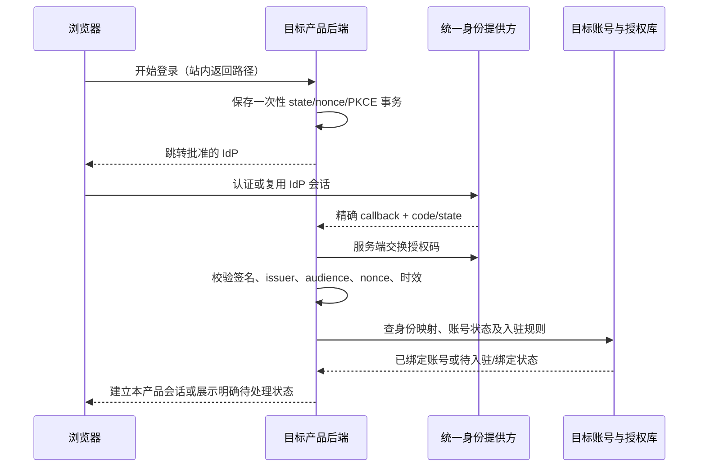

# 统一登录、项目授权与数据隔离设计

日期：2026-11-12。状态：评审后的设计约束，暂不开发；未接入 IdP、未改变账号/会话、未迁移数据。本文是[全项目对接方案](project-federation-plan.md)的身份与隔离专题规范，相关文档引用本文，不再各自维护不同授权流程。

## 1. 结论与责任分配

统一登录让用户在批准的产品间复用身份认证。每个产品继续决定用户能加入哪些空间、访问什么资源以及执行什么动作。Stars 首期是匿名静态门户，不是身份提供方，也不托管其他项目的会话。

| 责任 | 权威来源 | 不承担的职责 |
| --- | --- | --- |
| 验证统一身份、上游认证会话 | 经选择和验收的 OIDC IdP | 不根据一个全局 admin claim 自动授予所有项目管理员 |
| 旧账号绑定、本地会话、身份协议适配 | 每个产品的服务端/RP 或其同源 BFF | 不把浏览器填写的用户 ID 当成绑定证明 |
| 产品目录与应用注册 | Sun World 目录管理 | 不授予目标产品的成员资格，不保存所有业务数据 |
| 工作空间/商户成员、角色与资源授权 | 资源所属产品的业务服务 | 不信任来源产品的角色名称或前端能力投影 |
| 跨产品连接与用户委托 | 来源侧连接登记 + 目标侧授权记录 | 不把服务凭据当任意用户的权限 |
| Agent 运行与预算 | Sun World 运行服务；目标服务再次鉴权 | 不以 Skill、模型参数、工具可见性替代权限检查 |

Stars 如果以后显示“我的工作台”，必须先增加自己的同源 BFF/RP 并单独登记 client；静态页面不能保管 client secret、读取其他 origin 的 Cookie 或猜测全平台登录状态。F1 只展示“进入应用”即可。

## 2. 标识与隔离范围

此前目录里的 `project_id=frame-studio/metaphysics` 表示**产品登记 ID**，不是租户、工作空间或资源 ID。首期目录字段可保持兼容；内部语义命名为 `app_id`，禁止与帧集内部的 project_id 混用。未来字段改名需版本化，不在本轮修改契约文件。

| 标识 | 作用 / 规则 |
| --- | --- |
| environment | 生产/测试分别使用 issuer/client、凭据、数据库、存储和回调；不交叉信任 |
| app_id | 产品，例如 frame-studio、metaphysics；服务端从注册配置解析 |
| external_identity | `(environment, issuer, client_id, subject)`；精确匹配 issuer，subject 不做大小写或邮箱归一化 |
| local_user_id | 各产品自己的稳定账号 ID；不同产品的数字 42 无关 |
| tenant_ref | 目标定义的 typed scope，如 workspace、merchant、personal；必须由目标解析、验证成员关系 |
| resource_scope | 目标内部项目/门店/频道等下级范围；验证其属于 tenant_ref，不允许混搭 |
| resource_ref | `(app_id, tenant_ref, resource_type, resource_id)`，必要时带下级 scope 与版本 |
| actor / subject | actor 是实际调用服务/机器人，subject 是被代理用户；二者均可审计、分别授权 |

OIDC 可以为不同 client 发放不同的 pairwise subject，因此不能假定同一用户在两站的 sub 相同。统一登录不需要统一数据库主键。issuer/client/sector 变更属于身份迁移：保留旧映射，新键不得直接走自助注册绕过封禁；通过已验证旧账号或可信迁移证据建立对应，资源归属不变。跨项目委托必须通过目标认证/授权流程建立明确的来源主体→目标账号关联；不依据邮箱、手机号、昵称、Telegram ID 或同名 admin 自动关联。

授权上下文由服务端构造，至少包含环境、actor、subject、源/目标产品、目标租户/下级范围、能力、资源及委托记录。客户端可以选择空间，但只有目标服务验证成员关系后才产生有效上下文；缺 scope 不可解释成全部空间。无工作空间模型的单用户资源可用明确 personal scope，不为对齐字段捏造默认公共租户。

## 3. 登录与绑定是两个事务

### 登录时序

登录事务绑定当前浏览器临时会话、client、预期 issuer、用途与有效期；state 一次性消费，PKCE verifier 仅服务端保存。只接受登记回调与站内允许的 return path；拒绝任意绝对 next URL。授权响应不得写入完整 URL 日志。公钥从配置的 issuer 元数据/JWKS 取得，限制算法，不信任 token 自带任意 key URL；未知 key 有界刷新，无法验证则拒绝。

RP 校验 ID token 后只用其确认身份，不用它调用博客、素材或档案 API。多 audience 时校验相应 authorized party；新会话轮换 session ID，防止继承预登录会话。具体协议基线见[OIDC Core](https://openid.net/specs/openid-connect-core-1_0.html)与[OAuth 安全实践](https://www.rfc-editor.org/rfc/rfc9700.html)。这些是标准要求的参考，当前各项目尚未因此获得合规实现证明。

### 映射与绑定规则

- **已有映射：** 本地账号有效才能登录；被禁用/删除的本地账号不能通过另一入口自动重建。IdP 认证通过也不能绕过项目封禁。
- **没有映射：** 允许自助注册的产品可创建最小普通账号；不授予 workspace/store 成员资格或管理员。组织应用走邀请/审批；疑似同邮箱旧账号只提示通过原方式验证，不自动合并。
- **主动绑定旧账号：** 已登录本地账号且完成近期认证，另发专用 bind 事务；验证新外部身份的控制权，明确显示将绑定哪个本地账号，bind state 同时绑定目标 local_user_id 与本地 session family；回调消费后重验该会话仍有效、仍是同一账号且满足近期认证。途中退出、切号、绑定冲突或过期均失败，不降级为自动注册。绑定创建、冲突检查与审计同事务提交。
- **唯一性：** 外部身份键在本产品内唯一指向一个 local_user_id；绑定状态用 `pending/active/revoked`，事务唯一约束拒绝并发抢绑。一个账号可以经明确授权绑定多个外部身份；不能反向允许一个身份映射多个本地账号。
- **换绑与解绑：** 重新验证双方控制权，保留至少一条有效恢复路径，撤销关联会话与委托，并留审计；不得通过删除映射来绕过封禁。无法证明控制权时走受控恢复流程，不根据公开资料人工猜测。

绑定状态不是会话状态；撤销绑定不能只清 Cookie，已有 refresh token、连接授权和后台任务也需纳入撤销。与账号删除相关的映射 tombstone 按最小必要期限保留，避免删除后被旧回调重新激活。

### 凭据用途矩阵

| 凭据 | 谁验证 / 唯一用途 | 禁止复用 |
| --- | --- | --- |
| IdP Cookie | IdP 验证上游会话 | RP 或 API 不读取它 |
| ID token | 对应 client 的 RP 验证登录结果 | 不作业务 API access token |
| RP Cookie | 本产品的本地会话边界 | 不设置根域共享，不转发其他项目；若 Web/API 分离需先明确可信 origin 与 Cookie 归属，不能假定 host-only 跨主机可用 |
| 服务 access token / scoped API Key | 目标 API 验证机器身份与机器范围 | 不携任意 user_id 冒充用户 |
| 委托 access token | 目标 API 验证 actor、subject、scope 与撤销 | 不跨 audience、租户或转交其他工具扩大范围 |
| dsh run token | 内部工具/模型网关的特定运行 | 不替代外部项目连接凭据 |

浏览器只持目标 host 的会话 Cookie；跨产品令牌在后端管理。Web 与 API 分离时保留经过审查的当前 Cookie/Origin 方案，或者先实现同源 BFF；SSO 不是允许任意 credentialed CORS 的理由。

## 4. 会话、退出、撤权与故障

每个 RP 保存本地会话 family、local_user_id、外部身份键、上游 sid（如果提供）、认证时间、最近上游校验时间、绝对/空闲过期时间及撤销状态。不要求所有应用共享 Redis；保留产品自己的会话存储。

新联邦会话的设计基线：空闲 30 分钟、绝对 12 小时；敏感绑定/授权/发布的近期认证窗口 5 分钟。数值为待试点验证的目标，不修改现有用户会话配置。敏感操作要检查真实认证时间，不能用“刚刷新 token”替代重新认证。

| 动作 | 必须生效的范围 | 不承诺的范围 |
| --- | --- | --- |
| 当前产品退出 | 撤销该本地 session family、刷新凭据及绑定的短时委托 | 不声称 IdP 与其他项目也退出；用户主动再登录可能复用仍有效的 IdP 会话 |
| 退出当前统一会话 | 结束当前上游 sid，并传播到关联 RP 会话/委托 | 不等于全部设备退出；离线或未确认 RP 显示待同步 |
| 退出所有设备 | 近期认证后撤销账号全部已知上游会话与对应 RP 会话/委托 | 须验证 IdP 全设备撤销能力，未支持不能伪装同一按钮完成 |
| 项目角色/成员移除 | 目标产品即时更新权限版本；下一次业务检查拒绝 | 不修改其他产品无关权限，也不能收回已下载文件 |
| 全局账号禁用 | 阻止新登录、刷新和新联邦授权；传播到 RP | 不假定所有自包含 token 在广播前自动失效 |
| 工作空间/项目停用 | 阻断该范围的新查询、写入与任务续期 | 不删除数据或影响其他空间 |

全局退出优先采用经验收的服务端注销通知。RP 验证专用 logout token 的签名、issuer/audience、iat、events 与 sid/sub，并按 jti 去重；该端点不能把任意 JWT 当注销指令。通过身份映射定位，仅撤销匹配的本地会话与会话绑定委托，记录消费结果，不打印 token。账号绑定保持 active；解绑、删除或身份关系撤销由独立流程处理。[Back-Channel Logout 规范](https://openid.net/specs/openid-connect-backchannel-1_0.html)提供协议依据。sid 只在 issuer/client 关联范围内使用，不当全局唯一值。没有 sid 的通知按所选 IdP 已验收的 sub 范围语义处理，不能猜测设备；账户范围事件须明确对新旧会话的生效规则。新登录建立新会话关联，旧 sid 的迟到通知不能撤销不同 sid 的新会话；若 IdP 复用 sid 或无足够事件顺序证据，按保守重新认证处理，不能自行推测已恢复有效。

**通知用于加速，撤销时限不能只靠通知。** L2 私有请求的上游身份/会话有效性凭据最多缓存 60 秒，过期必须重验；绑定、授权变更、发布、委托签发等敏感操作要求在线重验。待选 IdP 集成必须提供可验证的账户/会话有效性或等效短租约机制；只支持签名验证或无法反映会话注销的 token introspection 不足以通过该门槛。若供应方做不到，保持独立登录，不降低要求假装完成统一退出。

60 秒约束的是上游状态检查缓存，不等于所有在途数据在 60 秒内停止交付。剩余租约不足以覆盖敏感提交时重验；长任务执行步骤、结果交付与新下载也复核租约和本地权限，并设在途 deadline。不能撤回已开始传输的字节，撤销验收分别报告新请求拒绝、在途提交与结果交付边界。

60 秒是目标设计上限，不是已实现保证：上线必须验证权威状态读取、时钟误差、通知重试和最坏失联场景。IdP/校验通道不可用时拒绝新登录/绑定/续租，私有读取仅可在未过期有效性窗口内继续；敏感操作立即失败关闭。公开博客、Stars 和匿名无档案计算按各自公开策略继续。不能退回未验签 token 或共享管理员会话。已知中央身份禁用/会话撤销优先于旧密码、QQ 等恢复入口；接入联邦管理的账号不能在 IdP 故障时用旧入口无条件续期。尚未接入联邦管理的本地账号按原策略运行，两类账号明确标记。必要的紧急管理恢复采用隔离、限时、审计的 break-glass 身份，不赋予普通用户绕过全局封禁的通道。

本地权限每次执行从目标权威状态判断；P1 不缓存 allow 决策。终态/敏感写入与本地成员/资源版本校验使用同一事务或条件更新。上游撤销与目标数据库之间没有全局事务，只承诺上面有界检查窗口，不能宣称跨库撤销与所有写入严格线性一致。

## 5. 权限判定和跨项目委托

普通请求必须同时满足：本地有效主体、目标产品准入、租户成员/个人所有权、所需能力、资源归属及状态条件。跨项目请求再叠加已批准的服务连接、委托范围和 actor 权限；各条件取交集，不做并集或角色兜底。

| 调用类型 | 允许依据 | 禁止行为 |
| --- | --- | --- |
| 用户直接访问 | 目标本地会话 + 当前成员/资源策略 | 前端 canEdit=true 直接放行 |
| 纯服务调用 | 服务身份 + 明确机器能力 + 固定目标范围 | 为方便加 user_id 后假扮任意用户 |
| 用户代办 | 服务身份 + 目标认可的用户委托 + 用户当前目标权限 | 仅来源产品登录就读取其尚未绑定的目标档案 |
| Agent 工具 | 上述代办约束 + 活跃 run/代次/工具白名单/预算 | Skill 或模型给自己添加 workspace、scope、owner |
| 支持/运维例外 | 目标显式支持能力、审批/近期认证、理由、时限与审计 | 通过普通业务 adapter 自动使用平台支持接口 |

跨项目访问令牌是目标 audience、限定 scope/租户/资源/时效的凭据，不转发来源产品 Cookie、IdP ID token 或 dsh 内部 run token。既有 scoped API Key 只能表达其已授予的服务权限；如不能表达用户归属，先不开启用户代办。

委托记录至少包含 actor、源主体映射、目标 local_user_id、目标 app/tenant/resource 范围、能力、发起会话或单独后台授权、确认方式、到期与撤销状态。目标用户通过目标登录/授权页面同意范围，来源服务只收到授权句柄或目标颁发的受限 token。来源用户 ID 字段不是证明。标准 token exchange 可作为未来实现选项，具体 IdP/目标不支持时不自造兼容声明，语义参考 [RFC 8693](https://www.rfc-editor.org/rfc/rfc8693.html)。

首期跨项目委托只用于用户当次操作，不自动获得离线长期代办权。设计目标 token 最长 5 分钟，但目标每次查询委托撤销和成员状态，不能把 TTL 当唯一撤销机制。用户退出触发撤销新调用；已受理任务按下面任务生命周期处理，不自动反复续签权限更大的 token。

确认、幂等与计费均绑定 actor/subject/目标 scope/参数摘要。写权限是访问条件，用户确认是本次动作意图，两者都满足才能写；确认不能授权原本无权的资源。

目录可见、可启动、可读摘要和可执行动作是四种不同权限。私有目录必须按用户/组织在服务端裁剪，只登录不意味着能看到所有内部项目名称、地址或健康状态。聚合摘要使用目标授权投影，不抓取管理页面；标注来源时间且不把 capability 发现列表当用户权限。

## 6. 各产品的资源权限

| 产品 | 隔离对象 | 权限落点与接入基线 |
| --- | --- | --- |
| Stars | 公共目录；未来用户自己的偏好 | 不读取业务私有数据。L2 个人区另建 RP，不复用其他产品 session |
| Sun World | 用户会话/草稿/运行，公开文章 | 公开读单独谓词；本人草稿；发布独立能力+目标范围+确认；博客 admin 不外溢 |
| 帧集 | workspace → 内部 project → asset/job | 目标检查成员和资源层级；同 workspace 内仍区分团队/私人项目；私人素材仅用于其所属项目，团队共同素材按目标规则引用；conversation/job 仅发起人可读，成员不自动可读。素材读取、文件下载、生成、本人对话和支持预览分别授权；独立后台预览属特殊通道，adapter 默认不可使用 |
| 命运/观象托管版 | personal owner → analysis → attachment/chat | 查询/修改/导出/附件下载都校验归属；默认无跨用户共享，照片与出生资料不进公共目录；本地版不宣称已具备这些权限 |
| 零点 | merchant → store → order；顾客本人订单 | 当前 README 记录单店构建，不能声称已支持多商户托管；目标设计把商户成员、门店角色与顾客归属分开，平台用户不是默认店员；支付/退款不作为首批跨项目动作 |
| swBot | 频道、会话与记录；渠道身份映射 | Telegram 用户/群与平台账号显式关联；群可见不等于私人记录可读；外部 API scope 不能越过会话归属 |
| 小黑 | 飞书群/私聊、允许的本机任务 | 默认私有渠道；禁止跨群读取/执行，主机终端不暴露为通用 Agent 工具 |
| 部署/BI/客户系统 | 组织、环境、项目及客户数据 | 独立组织成员和职责；个人门户 admin 不能执行组织部署或查询客户数据 |
| 桌面/素材/未知工作区 | 本地数据或尚未定义的资源 | 仅介绍/文档，不为统一入口自动上传或建托管账户 |

不存在一个跨全部产品的隐式超级管理员。运维确需跨范围支持时，由目标产品定义独立流程与审计，不能通过硬编码角色、共享密钥或“内部调用”跳过业务守卫。

## 7. 数据隔离必须覆盖整条链路

默认独立产品独立数据存储与数据库凭据，不为 SSO 合库。同部署多租户时，下面规则仍适用；资源 UUID、隐藏菜单或对象路径难猜都不是隔离控制。

| 层次 | 设计约束 |
| --- | --- |
| 数据库 | 仓储显式接收目标 scope；SELECT/COUNT/JOIN/批量更新/删除/导出均加归属条件，父子关系验证同 scope；复合唯一键/FK按数据库能力保护关系 |
| 缓存 | key 至少含环境、产品、tenant、授权主体/投影范围与资源版本；私有响应禁止公共 CDN 缓存；切换项目清理客户端缓存和未完成请求 |
| 对象/附件 | 上传在目标创建归属记录；下载逐次鉴权，HEAD/Range/缩略图/导出同样校验；签名 URL 不入日志、公共目录或跨用户缓存。签名 URL 有明确短 TTL（目标最多 60 秒），不能保证签发后即时撤回；需立即撤回的敏感照片使用鉴权代理流，不能返回长期 bearer URL |
| 搜索/向量索引 | 项目/租户权限在查询检索前过滤，不能先全局召回再在答案里删；索引与摘要属派生副本，删除需传播并对账 |
| 任务/队列 | payload 绑定 actor/subject/scope/委托/资源版本；执行与结果交付重新检查，不信任 UI 提交的 owner；幂等键按环境/产品/租户/主体/操作限定 |
| AI/工具 | 仅收集此次授权选定的资料；模型上下文、history、tool result、临时 home、预算、Provider secret 按 scope 隔离，不建立跨项目公共私有资料池；统一模型目录仅共享非敏感能力元数据，不共享费用账户、密钥或用户自定义 Provider |
| 日志/审计 | 记录 scope、actor、subject、能力、授权决策与关联 ID；默认不记录 token、原始档案/正文/照片；日志查询/导出也鉴权 |
| 备份/删除 | 备份仍受项目访问控制和保留周期；删除主记录不等于已删缓存/附件/索引/模型诊断。恢复备份必须重放删除/撤销台账后开放访问 |
| 前端/SSG | 私有资料不进入 HTML 预渲染、静态目录快照或浏览器持久公共缓存；迟到响应校验原账户与 scope，不能显示到新用户页面 |

跨项目工作流产生的派生数据必须登记来源资源、版本、授权范围、目标副本与保留期。源权限撤销后，默认禁止新的读取和派生展示；目标若确需独立保留，应在导入时明确“创建独立副本”的授权，不能默默把远端资料变成本地永久资产。元数据和引用也可能泄露信息，不只保护正文。

公开资料撤回另处理 SSG/CDN 传播，不能许诺从已下载文件或已发送模型上下文追回。核心项目功能不能依赖全量私有数据汇聚；门户只聚合目标授权的最小投影。

## 8. 长任务、移除成员与删除账号

跨项目异步生成分 `admitted/running/succeeded/failed/cancelled/unknown` 等目标状态，适配器保留目标 job ID。请求超时不代表未受理，不自动重放可能计费的动作。另存本地 cancel_requested 与远端状态；本地取消请求成功不等于远端已取消，只有远端确认才报告 remote_cancelled。回调验证来源、关联原 scope/job、去重并按允许的状态转换处理，迟到回调不能复活终态或改归属。

首期采用保守语义：成员被移除/用户撤销当次委托后，拒绝新步骤，尽力取消远端任务；已发生的计算或费用不能撤销。即使远端之后成功，也必须重新鉴权才允许查看或导出结果。结果暂存于原目标隔离域按保留策略清理，不因用户退出转为公共素材。自动持续工作须另建用户明确授权、可撤销的后台任务能力，不继承普通登录会话无限续命。

删除账户分产品本地删除与全平台关闭两种操作，不能同名按钮暗中扩大范围。全平台关闭建立逐产品回执和重试清单：先禁用身份、会话和委托，再按各产品资源策略处置档案/附件/索引/任务与备份台账。商户订单、组织资产等不能因某个人注销直接物理删除；其保留/移交由资源所属产品规则决定。产品离线时显示待处理，不标记全部已清除。

## 9. 上线前必须证明的场景

| 验收编号 | 场景 | 预期 |
| --- | --- | --- |
| ID-01 | 同邮箱不同 issuer/sub；不同 client pairwise sub | 不误绑、不按字符串相等猜同一人 |
| ID-02 | login/bind state 串用、重放 callback、并发绑定、恶意 return URL | 拒绝；唯一映射与审计无覆盖 |
| ID-03 | 本地封禁后 SSO 登录；解绑后旧会话/委托 | 不能新建账号绕过，旧权限被撤销 |
| ID-06 | 绑定途中退出/换账号、中央封禁后旧登录恢复 | 拒绝绑定与封禁绕过，旧账号归属不变 |
| ID-04 | IdP 断连、JWKS 未知 key、缓存有效期耗尽 | 拒绝不可信登录/私有续期，公开入口仍工作 |
| ID-05 | logout 重放/伪造/通知丢失、一个 RP 离线 | 匹配范围撤销；最长租约门槛可测；界面显示待同步 |
| AU-01 | 同一账号在帧集两个 workspace 有不同角色；伪造内部 project ID | 按目标关系拒绝，不因 app_id 相同放行 |
| AU-04 | 同 workspace 团队/私人素材、本人/他人对话、宽服务权限+窄用户委托 | 分别验权，以交集拒绝，不能借支持接口放行 |
| AU-02 | 博客 admin 调部署、成员用支持预览 API、scope 缺失 | 拒绝，特权不跨产品或从支持通道泄漏 |
| AU-03 | 仅服务 token+任意 user_id；错 audience；撤销委托 | 均拒绝，不能冒充用户 |
| DT-01 | 两产品/两空间相同资源 ID；批量/COUNT/JOIN/导出 | 无正文、计数、标题或存在性泄露 |
| DT-02 | 换账号/空间时迟到响应、缓存命中、预签名 URL | 不串数据；明确并测试 URL 有效期边界 |
| DT-03 | 执行中撤成员、远端返回成功、取消确认丢失 | 不新增步骤，不越权交付，不重复计费 |
| DT-04 | 删除后恢复备份、残留索引/附件、私有预渲染 | 删除台账重放，无私有静态副本，清理状态可追踪 |
| DT-05 | 跨项目模型上下文、临时目录、群聊会话与 Provider key | 不串账号/空间；日志无原始私有内容与凭据 |

这些是设计验收条件，尚无测试实现或通过证据。F2 托管档案必须先达到本地用户隔离要求；若没有已验收的本地认证/会话方案，应等待 F3 身份试点，不能以“SSO 在后面”跳过认证。F3 先选两个具备服务端会话和资源授权的产品（建议 Sun World 与帧集评估），不是选匿名 Stars 与本机观象凑数量。

## 10. 实施前待决且不可跳过

选定 IdP 的签名/算法/JWKS、pairwise subject、客户端登记、注销通知及有效性重验能力；明确各产品 60 秒上游租约的实现和实测。若达不到，不启用相关统一会话能力。

逐项目填资源 owner、tenant 层级、角色到能力映射、支持例外、附件路径、索引/缓存/备份清理策略与权限变更版本。保留旧登录恢复路径不代表可绕过新封禁：所有入口最终执行同一本地账号状态检查。

本轮只完成规范；数值上限、表名与场景编号不表示已有配置、迁移或测试。未决定 IdP 产品，也没有授权创建账号、搬迁数据或启动开发。
