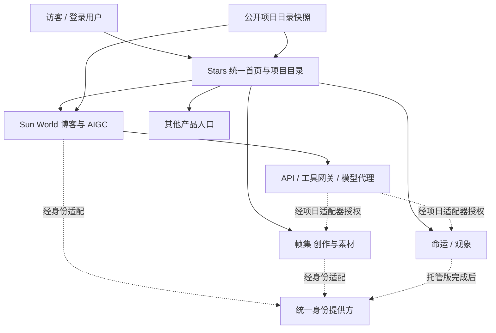

# 全项目接入方案：Stars 首页与独立应用协作

日期：2026-11-12。状态：设计提案，暂不开发、改域名或部署。依据本地项目资料和 Codex 项目清单；具体盘点及证据见[项目接入台账](../product/project-integration-inventory.md)。本文把[模块扩展契约](module-extension-contract.md)应用到实际项目，不将所有项目合并为一个应用。

## 1. 现在能对接到什么程度

**Stars 可以作为统一首页，第一阶段接项目入口；命运可以先登记产品介绍，云端档案与统一账号不能直接接。**

- Stars 已有项目星及链接数据，当前指向 Sun World 博客和帧集。适合承载品牌、探索与项目目录，不承担其他产品的数据或登录后端。
- 「命运」对应 `chinese-metaphysics-skill`，产品内名称为「观象」。已有 Next.js 工作台与 Python 引擎，但工作台是本机单用户，限制本机 Host/Origin。应保留本地版，另外设计托管适配，不通过放开 Host 就改成多用户服务。
- 帧集是 `ai-video/studio` 中的独立产品，不是 ai-video 根目录全部素材；它已有独立服务边界，可先作为项目入口，账号与素材 API 后续适配。
- Sun World 继续拥有博客、现有账号业务、AIGC 和后台。统一入口不要求先把 dsh 全部开发完，更不能绕过已有产品的访问控制。

仓库 2026-11-10 的 Stars 发布记录称主域名已切到 Stars、博客独立子域名。旧 `current-state` 与 README 仍有博客占主域名的描述。本轮公网读取工具未成功，**以下按历史记录设计，不声称已验证当前路由**；实际变更前必须先导出当前域名/路径/回源清单。

## 2. 产品结构与接入层次



实线表达拟议入口或服务关系，虚线表达后续接入，图不代表当前部署。用户可以从同一个首页进入不同产品；每个产品仍独立渲染、授权、存储和发布。

| 层级 | 交付 | 前置条件 | 不包含 |
| --- | --- | --- | --- |
| L0 产品登记 | 项目介绍、状态、分类、受众、批准链接 | 有可信 owner 与可公开信息 | 不产生业务访问权 |
| L1 入口互通 | Stars 项目星 + 普通目录 + 各站返回首页 | 真实可用入口、基本跳转与回退验收 | 不要求 SSO，不聚合私有数据 |
| L2 账号互认 | 统一身份、各应用本地会话和账户绑定 | 选定并验收 IdP、资源归属和注销 | 不自动共享数据或管理员角色 |
| L3 能力接入 | 类型化 API、业务工具、有限跨项目工作流 | 双侧鉴权、版本/幂等/错误/预算契约 | 不共享数据库，不透传任意 CLI |
| L4 体验与数据组合 | 私有工作台、授权摘要、受控 UI 包 | 项目隔离与撤销、数据投影和生命周期 | 不默认远程加载任意 JS/iframe |

L1 可以先交付，L2/L3 独立推进。把链接加入首页不是启用 Sun World 多租户；只有业务服务实际接受多个项目的数据时，才触发完整 ProjectContext 与键/缓存/配额隔离迁移。

## 3. Stars 首页如何承载所有项目

保留 Stars 完整观测站作为首页实现，不把旧简化 React 引擎当作完整页面移入 Sun World。主入口是 Stars 的 DOM/Canvas/Three.js 应用；React 包复用另行评估。本阶段采用**独立构建 + 项目目录契约 + 显式链接**，不采用运行时微前端。

首页有两个等价入口：星图中的项目星与可键盘访问的普通项目列表。列表须在 3D 引擎初始化前可用；加载失败、WebGL 不可用、低性能设备或减少动态效果时，仍可进入项目。星图不预加载其他项目 bundle，不请求命运档案、帧集素材或所有项目健康检查。

拟议页面区块：

- `portal.project-stars`：公开项目在星图中的表现；位置与颜色属于 Stars 展示层。
- `portal.project-directory`：同一公开目录的可访问列表，按探索、内容、创作、工具分类。
- `portal.account-entry`：L2 后按需加载登录入口；失败不阻塞星图或目录。
- `portal.footer`：备案、源码入口和必要站点信息，由宿主固定维护，不允许业务插件隐藏。

这些是语义扩展点，不强行让 Stars 实现 React `AppModule`。Stars 使用自身 renderer 适配同一数据；Sun World 使用其 route/nav/slot；Next.js 项目使用自己的 layout。共享数据契约不等于共享 UI 框架。

公开目录只能包含公开产品。内部部署、机器人管理、客户系统及尚未核实项目只出现在鉴权后的管理目录，不得以“隐藏卡片但下载全部 JSON”实现保密。命运当前仅能显示介绍/本地使用说明，不能在公共网页写死 localhost 链接或探测访客本机端口。

## 4. 项目目录契约与仓库归属

Sun World 维护一份受审查的项目登记源；生成不含秘密的版本化公开快照，Stars 构建时固定版本消费。首期即使 API 不可用，首页仍能加载最近发布的目录。私有目录通过登录后的 API 按用户与组织资格单独投影；可见、可启动、可读摘要、可执行动作分别判断，绝不进入公开构建产物。

拟议目录记录：

```json
{
  "schema_version": "1",
  "project_id": "metaphysics",
  "label": "命运 · 观象",
  "kind": "product",
  "audience": "public",
  "availability": "local_only",
  "integration_level": "catalog",
  "launch_url": null,
  "description": "历法计算与传统文化研习工作台",
  "capabilities": []
}
```

此处 `project_id` 是产品登记 ID（语义 app_id），不是数据租户；业务范围见身份隔离专题。未托管项目 `launch_url=null`，由宿主生成非跳转介绍卡。目录的 capabilities 只是可发现的能力说明，不是授权。字段另需 owner、版本、说明链接、批准 origin、更新日期；内部地址与运维细节放私有记录。链接允许列表校验 HTTPS、禁止脚本/数据 URL 与用户可控跳转；远端改域名需审查目录版本。

拟议文件布局（本轮不创建代码目录）：

```text
sun-world/
  docs/product/project-integration-inventory.md  # 产品/内部/待确认清单
  docs/architecture/project-federation-plan.md   # 本方案
  apps/api/src/modules/project_catalog/         # 登记、公开/私有投影
  apps/api/src/modules/integrations/adapters/   # frame、metaphysics 等独立适配器
  packages/contracts/projects/                 # 生成目录/API 契约
stars/
  src/observatory/data/projects.ts              # 现有入口，未来消费固定快照
  src/observatory/                              # 保持自身页面与渲染结构
chinese-metaphysics-skill/
  src/chinese_metaphysics/                      # 保留离线计算核心
  web/                                         # 保留本地版，托管支持单独设计
ai-video/studio/                                # 保留现有 Cloudflare 部署边界
```

测试位置沿用[文件规范](../repository-conventions.md)，跨仓库补 consumer contract fixture，不能以 sibling 路径 import 源码实现生产依赖。首期不建立全项目 monorepo；只有两个真实消费者需要同一纯展示组件时才抽取包，先检查构建与许可证约束。Stars 当前许可证及源码分发入口必须在集成评审中保留，不因统一品牌删除其源码产物。

## 5. 域名与路由安排

| 入口 | 目标 | 决策状态 |
| --- | --- | --- |
| `sunworld.site` / `www.sunworld.site` | Stars 首页、项目目录 | 历史发布记录已有；当前回源待核对，保持现有 canonical 策略 |
| `blog.sunworld.site` | Sun World 博客、现有工作台入口 | Stars 链接与历史记录支持；不搬文章路径 |
| `api.sunworld.site` | Sun World API | 保留现有协议，不把所有外部 API 硬塞到这个域名 |
| 帧集现有批准地址 | 帧集 Web | 优先保持已有链接；自定义域名以后独立切换 |
| 命运未来产品子域名 | 托管观象 | 名称未定、尚未启用；本地版不发布 |
| 未来身份入口 | 选定的 IdP | 未选定，不把现有 `sso` 模拟器部署成生产身份中心 |

主域名原有 `/blog/:id`、`/blog?id=...`、`/aigc`、编辑与登录路径必须盘点。仅对确认存在的旧路径建立精确重定向或兼容路由，保留合法 query/fragment 与 OAuth 回调行为；不能用一个 SPA fallback 把旧文章链接变成星图。文章 canonical、sitemap 和搜索索引只指向一个正式内容地址。

公开 GET 文章可使用固定目标重定向；POST、SSE 和 OAuth callback 不套用通用重定向。认证回调先保留提供方登记的精确地址，完成新回调白名单与协议验证后再退役旧入口，不把授权 code/state/token 转发到任意新 origin。

### 发布与认证归属：F0/F1 阻断项

本仓库 `.github/workflows/deploy.yml` 仍有创建 `my-frontend`、映射 `8081`、对主域名/WWW 做前端探测的代码，`docker-compose.yml` 也使用该容器与端口。工作流内 CORS/CSRF 默认允许来源未包含博客子域名。这是本地配置证据，不能推断服务器当前实际值。

实施前必须填实以下表格，不能仅靠“两站各自部署”口头约定：

| 服务 | 域名/路径 | 实际回源与容器或产物目录 | 唯一写入该产物的发布任务 | 回滚版本 |
| --- | --- | --- | --- | --- |
| Stars | 主域名/WWW 及其 assets/data/source 等 | 待服务器只读核对 | Stars 发布任务；核对旧每日 timer 是否仍覆盖该位置 | 待核对 |
| Sun World Web | 博客子域名及旧路径兼容 | 待核对，不能直接沿用主域映射假设 | Sun World Web 发布任务；健康检查应验证实际博客内容 | 待核对 |
| Sun World API | API 域名 | 待核对当前 API 容器 | API 发布任务 | 待核对 |
| 帧集 | 已批准 Worker 域名 | 按该项目部署记录确认 | 帧集自己的 Cloudflare 发布任务 | 待核对 |

阻断条件：同一根目录/容器由两个项目写入、旧定时发布会覆盖 Stars、博客探测只收到 Stars 的 HTTP 200、资源路径冲突。应以应用标识/产物摘要验证部署对象，不能只测 HTTP 状态。必须同时盘点 DNS/Nginx/Cloudflare 与所有手动/定时发布入口。

认证验收须覆盖博客子域名登录、刷新、写入、退出、OAuth callback、过期会话与 CSRF 拒绝。精确允许实际业务 origin，禁止通配放行；Stars 首期只做公共链接，不因历史设置自动获得博客写请求 origin 权限。现有 Cookie 与回调迁移作为独立兼容步骤，不随首页换肤隐式改变。

默认跨子域整页导航，不代理完整 Next.js 到任意子路径；后者涉及 basePath、静态资源、回调、Cookie 与流式协议，只有明确需求后再评审。Stars 的开发中继不是生产 API 网关。

ICP 必须在新首页宿主可见，使用现有备案号及链接；不能因为博客仍有备案而漏掉主域名。3D 故障的普通列表页也包含站点固定信息。

## 6. 统一身份与数据隔离

详细规则集中在[统一登录、项目授权与数据隔离设计](federated-identity-and-isolation.md)，评审发现与处理见[专项评审](../reviews/2026-11-12-federation-security-review.md)。保留独立 RP、本地会话和目标服务授权，不因账号互认合并角色或数据。

- Stars 首期保持匿名；个人菜单/私有目录需先增加自身 BFF/RP，不读取其他项目 Cookie。
- 产品目录 project_id 只表示 app_id；帧集的 workspace/内部项目、零点的门店和命运的档案归属另行验证。
- 登录与主动绑定分别发起一次性事务；禁止同邮箱自动接管、在绑定中切换本地账号或用失效会话完成连接。
- 统一退出需要上游会话到本地 session family 映射、通知校验与有界有效性重验；不承诺跨存储即时全局撤销。
- 服务身份、用户委托、ID token、RP Cookie 与 dsh run token 分用途；有效业务权限取当前用户、服务连接、委托与目标资源策略的交集。
- 数据隔离覆盖数据库、缓存、文件、任务、索引、AI 上下文、审计和备份恢复；聚合目录与摘要也需服务器授权过滤。

目标 IdP 尚未选定；本地 sso 仍是联调模拟器。60 秒上游有效性窗口、近期认证与会话时限均为专题文档中的待验收设计，不是已生效配置。未知部署/实现能力不能用标准术语补成已完成。

## 7. 命运 / 观象的接入路径

推荐保留本地版，并新增受限托管模式，分两步：

1. **无档案的纯计算能力。** 封装现有 Python 核心，固定输入输出 schema、版本、时区与计算边界；提供无持久化的限定计算 API。设请求体/计算时限/频率上限，不记录出生输入到访问日志，不自动调用 AI。是否公开匿名计算在资源验证后决定。
2. **登录后的档案与 AI 研读。** 在项目侧补真实用户、档案/照片/对话归属、附件授权下载、配额、删除及备份策略，再开放托管 UI。先设计现有 SQLite 单用户数据如何隔离或迁移，不能只加一个登录页。

本机 Codex app-server 登录、文件路径和 `.data` 不进入服务器共享环境。托管 AI 使用服务端管理的模型连接与逐用户限额；发送出生资料或照片前沿用明确选择范围，不默认把整个档案送往跨项目模型。Sun World 只保存外部资源引用，不复制全部档案或附件。

第一批 Agent 工具候选为无持久化历法计算，后续才增加本人档案查询；不开放任意 CLI 参数、文件读取、照片全量导出或替他人改档案。运行时产品 Skill 从原研究资料中提炼，只引用批准工具，不把开发 Skill 的安装、登录与本机命令直接打包到 Worker。

Stars 展示星空与观象的传统文化解释保持产品边界：首页不根据出生档案自动生成“个人星球”，也不把天文渲染与术数结果混作同一科学计算。用户私有数据不进入公开项目导航。

## 8. 帧集、机器人及其他项目

- **帧集：** 首期链接到现有 Web；后续在 Cloudflare 服务边界上加受限外部适配，不绕开 Service Binding、原用户会话和私有素材权限。跨项目生成采用异步 job ID、预算预留与幂等请求；Worker/远端超时结果不明时先查询，不重复计费执行。首页不显示私有素材缩略图。
- **swBot：** 作为消息渠道和未来通知适配器，不作为公开 Web 子页面；按频道/账户绑定限制查询与动作。产品通知写操作需用户明确配置订阅和接收目标，模型不能从聊天里随意决定联系人或群。
- **LingDian：** 独立点餐业务与商户数据域，可登记受限入口；账号、订单、门店/商户权限单独评审，不继承博客管理员。
- **upup 与其他真实产品：** 先登记与跳转，再按自己的本地/托管成熟度接身份和 API，具体记录见台账。
- **素材目录、空工作区、脚本仓库：** 可以登记状态，不伪造在线入口或新建空应用。
- **BI、客户 Demo、部署平台与基础设施：** 私有管理目录；不进入公开 Stars 快照。跨组织接入先确认所有权和发布边界，再做隔离适配，不能由“接全部项目”推导为公开客户数据或开放部署命令。

## 9. 分期、验收与回退

| 阶段 | 范围 | 放行条件 | 回退 |
| --- | --- | --- | --- |
| F0 现状核对 | 台账、域名/路径、发布归属 | 确认主域名与博客实际回源，登记 owner/公开性；只读检查 | 不改变运行环境 |
| F1 首页与入口 | Stars + Sun World + 帧集，命运介绍 | 项目目录与星图一致、3D 失败可导航、旧链接/ICP/源码入口/移动端通过 | 回退目录快照和 Stars 版本，其他项目不动 |
| F2 命运受限托管 | 先纯计算，后用户档案 | 核心回归、资源限制；档案阶段先有已验收的本地身份与会话，另验双用户附件/查询隔离与删除；否则等待 F3 | 关闭托管入口，保留本地版及用户导出能力 |
| F3 身份互认 | 选择 IdP，先两个产品试点 | 完成专题 ID/AU/DT 验收，IdP 能力与上游有效性窗口实测通过 | 停用新绑定，保留映射；恢复入口遵守中央封禁与本地状态，不回退为无条件旧登录 |
| F4 业务/Agent 接入 | 每次一项 read/compute/job 能力 | 双侧鉴权、幂等、预算、取消、外部故障及审计 | 单适配器停用，独立产品继续服务 |
| F5 其余项目 | 按台账成熟度逐项接入 | 项目 owner 和公开/私有范围明确，重复上述验收 | 回退项目登记，不整体停站 |

这里 F 表示跨项目接入阶段，不替代 DSH A–G/P0–P3。F1 不依赖 dsh；F4 的 Agent 调用依赖 DSH 运行与权限门槛通过。纯项目链接无需先完成所有业务表的多项目迁移，跨项目数据聚合则必须完成涉及服务的隔离。

部署各自独立：Stars 静态资源、Sun World API/Web、帧集 Cloudflare、观象未来托管各用自身构建、锁文件和回滚版本。不让统一首页发布触发全部项目部署，也不把 Node/Python/视频任务同时塞进小规格服务器。成本与容量在各阶段实测后定，不用 P0 样本估算全平台承载量。

F2 的纯无档案计算可以先行；托管档案若无可靠本地认证则依赖 F3。身份接入与产品托管是依赖关系，不为按表格顺序交付而跳过认证。具体执行验收以专题第 9 节为准。

## 10. 当前未决项

- 主域名/博客的实时回源与历史链接兼容清单：现有记录冲突，实施前核实；本轮不写入已验证生产状态。
- 命运最终公开名称、托管子域名及首批计算模块：设计暂沿用「命运 · 观象」，域名待部署任务决定。
- IdP 实现与账号迁移、跨站退出：专门试点，不使用现有 sso 模拟器冒充生产认证。
- 工作区以外、云端或未识别项目：台账保留“待确认”；发现新项目走同一登记，不声称本次穷尽所有资产。
