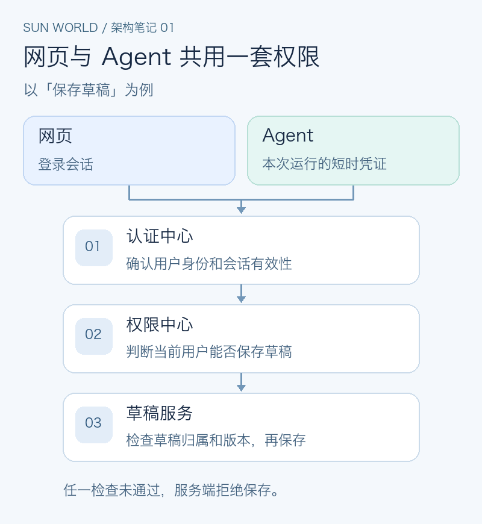

# Sun World 架构笔记 01：让网页和 Agent 共用一套认证与权限

Sun World 准备把博客按业务划分为全栈模块。一个模块可以包含页面、后端服务、数据库迁移，也可以通过 Tool 和 Skill 向 Agent 开放能力。这个设计首先要回答一个问题：同一个人从网页点击「保存草稿」，或者让 Agent 帮他保存，后端如何确保两次操作遵守同一套规则？

## 我们已经有了什么

仓库中已经有三块基础能力。现有博客的公开阅读和管理入口已经分开。以下是仓库里的实现，线上启用的登录方式以部署配置为准。

- **身份与会话。** 账号有稳定的用户 ID。登录成功后服务端通过 HttpOnly Cookie 建立会话，Redis 跟踪每台设备的活跃会话，支持刷新与退出。仓库里已有第三方身份绑定和联系方式验证模块，负责把验证通过的身份归到站内账号。
- **角色与资源。** 用户可以拥有多个角色，角色可以关联资源。管理后台已有角色与资源的管理能力。页面、接口和操作可以由稳定的资源代码标识。
- **实际访问控制。** 以文章为例，公开读取可以匿名访问，现有创建、更新和删除接口使用管理员角色守卫。AIGC 等个人数据通过用户 ID 限制查询范围。角色与资源关联已经能查到，但各业务入口目前还没有统一按细粒度能力作授权判断。

因此这次的工作是把已有的登录、角色和资源整合成两个清晰的服务边界，再逐步把业务入口迁过去。

*图 1。保存草稿时，两个入口都经过同一套后端检查。*

## 认证中心负责确认调用者是谁

认证中心先作为 FastAPI 内部的公共模块。它负责登录方式、账号绑定、会话创建与刷新、注销、账号禁用以及敏感操作的近期认证。模块对业务提供统一的主体对象，包含调用者类型、稳定的账户 ID 和会话引用。将来有多个独立应用需要共享登录时，再评估单独部署和标准 OIDC 接入。

网页请求用现有 Cookie 恢复会话。Agent 则有两个需要区分的身份：运行它的 Worker 服务，以及授权这次运行的用户。FastAPI 在启动任务时记录归属账户、允许调用的工具、执行代次和到期时间，再发给 Worker 一个只对本次运行和指定网关有效的短时凭证。工具参数里即使出现 `user_id`，后端也只使用自己保存的归属信息。用户退出、账号被禁用或任务被取消后，网关拒绝新的调用。

## 权限中心负责判断这次操作能不能做

角色把一组能力授予用户。能力按业务命名，例如 `blog.draft.write_own`、`blog.article.publish` 和 `comment.moderate`。模块在代码里声明能力键，后台维护角色和能力的关系。授权服务先确认主体有对应能力，业务服务再检查具体资源的所有者、可见性和状态。前端用能力结果控制入口是否显示，最终决定在服务端执行。

| 操作 | 平台判断 | 模块判断 |
| --- | --- | --- |
| 搜索或阅读文章 | 允许公开读取 | 文章已公开，且正文可读取 |
| 保存草稿 | 用户拥有草稿写入能力 | 草稿属于当前账号，版本没有变化 |
| 发布文章 | 用户拥有发布能力，并明确确认 | 确认对应同一篇文章和版本，内容状态允许发布 |
| 管理角色 | 用户拥有权限管理能力，并完成近期认证 | 授权变更经过审计，保留管理员恢复路径 |

保存草稿时，所有者由服务器从登录账号赋值。作者显示名仍然可以是笔名。发布确认绑定具体操作、文章和版本。如果确认后内容改了，就需要重新预览并确认。角色变更和禁用状态在真正执行时重新判断。后台展示、Agent 工具可见性和 Skill 提示都只帮助调用者选择下一步。

## 从哪里开始

1. **先跑通只读原型。** 注册「搜索公开文章」和「读取公开文章」两个工具，让 Agent 在独立进程中完成一次带来源的回答。只把确实查到的站内文章作为引用，验证超时、取消和不同账号之间的隔离。
2. **接入统一授权。** 先为新入口定义能力键，再逐个迁移现有入口。用角色矩阵、跨账号操作和权限撤销测试验证行为，分阶段确认管理员兼容，避免权限调整让现有管理工作中断。
3. **再开放草稿。** 让网页和 Agent 共用草稿保存服务，验证作者归属、并发版本和重复提交。发布单独验收，因为当前文章元数据和正文分开存放，需要先验证版本切换和回滚。

这篇记录的是架构设计和代码核对结果。Astra 已完成独立设计审查。下一次更新将记录只读原型实际跑出的工具调用、权限校验和运行结果。
