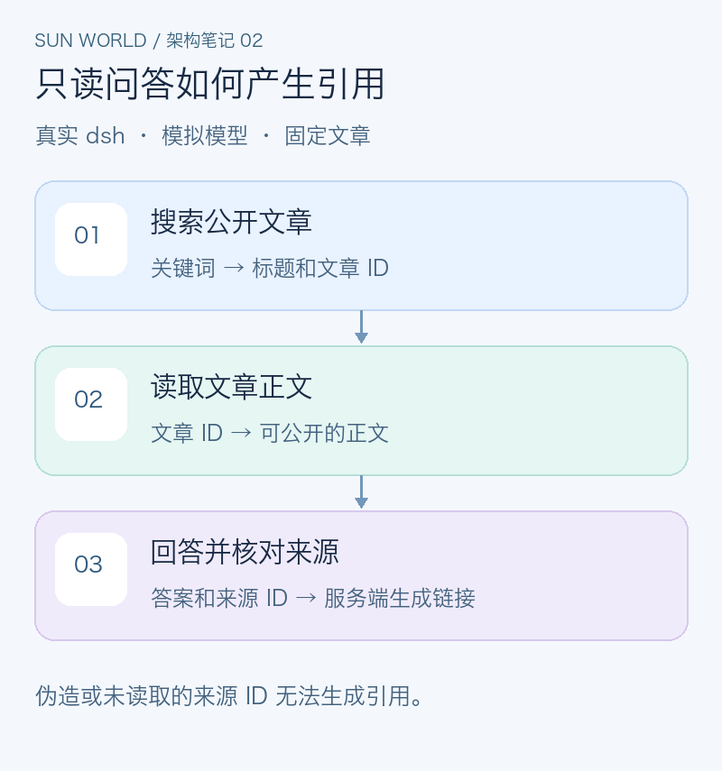

# Sun World 架构笔记 02：用 dsh 跑通只读博客问答

如果 Agent 回答「React 编辑器怎样处理快捷键？」时附了一篇站内文章，我们怎么知道它真的读过？这次本地原型把搜索、读取和引用拆成三步，用一篇测试文章验证结果能沿着同一条链路回到答案。

## 从搜索到引用

我们启动了真实的 DeepSeek Harness 子进程，通过它的 SDK 提交问题。运行环境只给模型两个工具：搜索公开文章、读取公开文章。测试用的模型服务遵循 DeepSeek Messages 的流式协议，按固定场景发出工具调用。测试文章中有一篇公开文章和一篇未发布草稿，用来验证读取边界。

*图 1。搜索返回标题和 ID，读取返回正文。引用链接由宿主根据实际读取记录生成。*

这条问答用了三次模型请求。第一次要求搜索「React」，工具找到《React 编辑器的命令分层》。第二次用文章 ID 读取正文。第三次收到正文后返回「快捷键映射为编辑命令，命令再提交可撤销事务」，同时带上来源 ID。宿主只接受本次确实读取过的 ID，并据此拼出测试链接。这样可以验证来源是否经过工具，但仍要单独评估回答是否准确表达了原文。

## 特意测试失败的路径

| 场景 | 本地结果 |
| --- | --- |
| 搜索无结果、尝试读取未发布文章 | 返回空结果，不生成引用 |
| 模型请求未注册的工具 | dsh 返回工具错误，博客网关未被调用 |
| 模型编造引用、输出因 token 上限截断 | 宿主拒绝提交这次回答 |
| 问题以 `/help` 开头 | 按普通问题提交，照常搜索和读取 |
| 模型不返回结果、调用者取消 | 记录对应终态，关闭本次 dsh 进程并清理临时目录 |

每次问答用独立进程和临时目录。连续两次故意复用同一个逻辑会话 ID，第二次仍没有收到第一次的标记。运行时只连接本机回环地址，对外地址和仓库文件的访问探测均被系统拒绝。

这次验证的是 dsh 和博客工具之间的协议、权限边界以及引用规则。测试模型按预设步骤走完流程。下一次要用真实模型确认它能自己选对工具、读懂正文并引用正确的文章，再评估接入博客内测。
