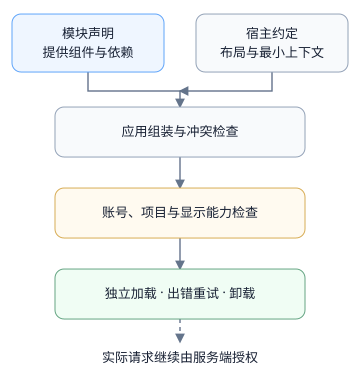

# 架构笔记 03｜给博客 Agent 划清 Skill 与工具的边界

给博客接上问答后，很容易想到继续加入写作、草稿保存和发布。仓库里已经有文章写作 Skill，AIGC 页面也支持用户保存自己的 Skill，看起来只要把它们交给同一个 Agent，就能串起整套流程。

这里需要先区分：这些 Skill 的使用环境不同。开发环境中的发布说明可能涉及本机命令和管理员会话；用户 Skill 是个人提示词；产品问答 Skill 则要在服务器上面对不同账户的输入。直接把它们放进同一个加载目录，会让运行环境和授权关系变得难以判断。

以下是 Sun World 的实现设计。现有只读问答原型验证了固定文章与模拟模型的协议链路，本地已接通工具声明与共用公开查询，独立本地验证环境已跑通真实模型的只读问答，并接入站点已有账号与公开博客查询供本地验收；生产运行授权与草稿发布仍需实施。

## 一、三类 Skill 分别由谁使用 {#skill-ownership}

Skill 负责描述工作方法，例如先搜索，再读取正文，最后返回来源 ID。是否允许读取某篇文章、是否允许保存草稿，仍要由应用检查。

| 类型 | 使用位置 | 装载方式 |
| --- | --- | --- |
| 开发协作 Skill | Codex 等开发环境 | 按开发任务读取，遵循该环境的工具与用户授权 |
| 产品 Skill | 服务器上的博客 Agent | 随代码审查发布，固定版本，构建时放入只读资源 |
| 用户 Skill | 现有 AIGC 普通聊天 | 作为账户范围内的提示词，不能增加工具权限 |

仓库的 `.agents/skills/` 继续服务开发协作。产品里的 `blog-qa` 则由博客模块维护，只依赖经过批准的搜索和读取工具。首期博客问答不装载用户自定义 Skill，普通聊天保持现有功能。

这样会多出一份面向产品的问答说明，但它的职责更小：不用携带开发命令、环境配置或发布凭据的处理方法。后续做草稿创作时，再从写作技能中提炼产品需要的部分。

## 二、工具调用回到同一个业务服务 {#shared-service}

假设用户在网页上编辑一篇草稿，同时让 Agent 帮忙修改。两种入口如果各自实现权限和版本判断，就容易出现网页拒绝、Agent 却保存成功的情况。

这里让 HTTP 路由和工具适配器调用同一个博客应用服务：

```text
网页请求 → HTTP 适配器 ─┐
                      ├→ 博客应用服务 → 归属、版本检查 → 仓储
Agent → 工具网关 ──────┘
```

工具网关先验证运行身份和允许调用的工具，再由应用服务检查实际资源。即使模型在参数中填写另一个作者 ID，服务端也不会据此决定所有者。**草稿归属来自当前账户，展示名只用于显示**。

工具注册也需要同一来源。本地实现把搜索、读取的输入输出和所需权限集中声明，再生成供 Worker 使用的工具目录；重复声明、缺失依赖或生成结果与声明不一致时，检查会拒绝通过。这样可以避免不同语言各写一份后逐渐偏离。目录生成只验证声明；本地 Worker 已接入只读验证链路，但生产执行仍未开放。

公开文章的读取也已收拢到同一服务：网页查询和工具读取都要求文章未删除且正文存在。列表只检查当前候选页，缺正文时允许少返回几条，分页仍按已查询的候选范围前进，避免为了补满列表不断扫描。工具读取还限制返回正文的字节数，保留截断信息；本地运行网关已限制整次问答的累计用量，正式账本与网关已在独立本地环境验证，生产接线仍未开放。目前还提供一个独立的本地验证入口：使用测试账号和合成文章，模型真实执行搜索、读取，再由应用核验参考来源。刷新能够恢复运行结果，取消后迟到回答不能覆盖状态。合成入口帮助检查交互与协议衔接。另一个站点模式复用现有登录会话、当前账号权限和公开文章查询，只向本地验证名单开放，参考链接回到正常博客详情页；已通过正常管理员登录核对提问、真实文章引用、刷新、取消和退出；验证时明确选用本地测试模型，这不代表生产模型配置和隔离已经完成。本地模型答对几道问题，同样不能替代系统的回答质量评测。

迁移现有管理入口时，还要避免把“新策略已经写好”当作切换完成。本地先为现有管理员操作列出明确基线，在旧鉴权之后并行比较候选结果；出现差异时只记录供核对，实际放行仍遵循旧判断。这样可以先发现新策略漏掉的入口，而不让比较本身改变用户权限。新增入口、移除守卫、重复注册受保护路径，以及前置公开动态路由遮挡管理员入口，都要在检查时被发现。**管理员在网页上能编辑文章，不会因此获得 Agent 发布权限**。角色绑定的页面或按钮记录也需要单独核对，不能直接变成工具授权。

权限迁移也不能只看路由代码。账户绑定了哪些角色、角色目录是否出现空码或重复码、绑定是否指向已删除对象，都要在实际数据中核对。这里先用数据库强制只读的同一快照做汇总，角色名称按现有判断的规则归一化，结果只保留计数。即使没有发现结构问题，也不能据此自动切换授权：资源目录为空时无法从中还原细粒度权限，只有一名管理员时还要单独验证恢复路径。**盘点是建立迁移依据，不会为模型增加工具权限**。

维护操作还要保证不会把启用管理员清零。本地已把账号停用、角色替换及角色改名删除放进共同事务，并给9项账号与授权维护写入接上近期认证。真实临时数据库验证了并发撤权时后一个请求等待并重新判断，以及普通刷新不能延长初次认证证明，具体见[管理员事务案例](2026-11-17-last-administrator-transaction.md)。这不代表全部管理能力或审计迁移完成，真实凭据可用性和人工恢复仍需单独验证。

## 三、运行版本也要留下记录 {#versioned-execution}

Skill 改了，模型生成的结果也可能变化。因此运行记录除了保存用户与问题，还要保存 Skill、工具和 profile 的精确版本或内容摘要。

读取运行记录还涉及并发请求。刷新页面、另一标签页读取历史、点击停止，可能同时复用一个登录会话。凭据引用需要跟随每个请求计数，单个请求结束只能释放自己持有的引用，不能删掉其他请求仍在使用的会话上下文。否则模型已经完成回答，页面仍可能在最后一次校验时误报登录失效。本地适配已为查询、取消和结果流分别保留引用，并在请求结束时释放；这不延长登录本身的有效期，退出后的会话重验仍会拒绝。

这份记录首先用于回答“当时运行了什么”。它还可以避免一轮问答中途切换配置：运行开始时选定工具和 Skill，后续工具调用必须与这次运行匹配。权限变化则不沿用旧快照，仍然每次检查当前状态。

需要注意，**固定 Skill 版本不等于固定用户权限**。用户退出登录或管理员关闭问答能力后，后续工具调用和最终提交前的检查应拒绝已生效的撤销。会话状态与业务写入跨存储，不能仅靠一次检查宣称与所有并发提交严格排序。已经发给模型的公开资料无法收回。

首期继续采用单轮、独立进程和独立工作目录。这样每次启动有额外成本，但不用同时解决跨轮状态恢复、进程复用和账户隔离。等真实模型与 Linux 隔离验证完成，再判断是否值得复用运行时。

## 四、先接公开读取，再处理发布 {#read-before-write}

当前博客的元数据与正文分别在 MySQL 和 MongoDB 中，旧读取主要依赖删除标记与正文是否存在。这还不是完整的草稿和发布模型，所以不能给工具加一个“发布”名称就直接开放。

读取阶段先把公开查询抽出来，让网页与 Agent 使用一致的数据范围。模型返回来源 ID 后，应用检查本次读取结果的交付回执，并复核正文及公开状态，再生成站内链接。跨库复核仍存在时间窗口；该检查不证明模型理解正确，回答质量需要另外评测。

草稿阶段使用独立数据表，通过账户 ID 和预期版本控制保存。发布再增加不可变正文版本与公开指针，并把标题、摘要和标签纳入同一公开快照。如果只切换正文，却提前更新标题，读者仍可能看到新旧内容混合的文章。

这套分期让只读问答可以先验证价值，同时给草稿和发布留下清楚的实施门槛。后续其他项目通过明确的项目授权与版本化适配器接入，复用 Skill 或 UI 不会获得另一项目的数据权限。具体目录、运行状态与验收条件记录在[实现规范](../architecture/dsh-implementation-standard.md)中；草稿发布与跨项目业务接入仍是设计，不据本地只读链路自动开放。


## 五、页面扩展不携带工具权限 {#page-contributions}

模块除了提供业务工具，还需要在页面里放入自己的入口。如果 AI 工作区每接入一个模块，都要直接引用它的内部组件，布局、加载和出错处理就会不断混在一起。这里先把现有博客问答入口改为静态贡献：博客模块声明提供什么，AI 宿主决定放在侧栏还是折叠栏，应用组装时收集双方的声明。



宿主约定可接受的上下文、版本和数量，组装时拒绝重复标识、不兼容版本、缺失依赖和未知扩展点。贡献按稳定顺序展示，不能从后端下载任意脚本，也不能自动取得对话或文章全文。这样增加一张卡片或一个入口时，模块提供内容，宿主继续掌握布局和交付的数据范围。

**公开入口不需要运行权限，显示检查也不授予运行权限**。博客问答链接只帮助用户找到页面，因此不假造一组已授权能力；真正提问仍由服务端检查登录、名单与配额。需要限制显示的贡献则等待明确的能力结果，要求的各项能力必须全部满足。能力尚未加载、加载失败或已撤销时，不先载入受限组件。

加载和退出也由每个贡献独立处理。某个区块失败，只显示它自己的重试入口，其他区块和主工作区继续使用；切换账号、项目或会话时，旧组件卸载并收到取消信号。迟到的加载结果不能回到新上下文，后台请求也要使用该信号并核对原上下文。**卸载保护的是当前页面，不能撤回已经执行的服务器操作**。模块代码可以由浏览器复用，账户业务数据不能因此跨范围共享。

本地实现先覆盖这一个公开入口，并检查错误隔离、重试、能力变化和卸载。用于切换项目的合成上下文只验证组件生命周期，不代表第二项目的数据隔离已经上线；其他页面区块和写操作仍按真实需求逐项接入。

## 六、从统一入口到跨项目工具 {#project-entry-and-tools}

Stars 已有进入博客和帧集的项目星。把命运等项目加入目录，可以让用户从同一个首页发现它们，但入口统一还没有解决登录和数据归属。比如命运对应的观象工作台目前只面向本机单用户，不能因为首页增加一个链接，就把档案和照片直接放到公网。

这里把接入分成三个层次：先登记项目与访问入口，再让具备条件的应用互认身份，最后开放有范围限制的业务工具。各项目继续保存自己的数据，工具适配器负责把请求送到拥有资源的服务；共享账号也不意味着共享管理员权限。

统一登录之后，权限还要按目标项目检查。例如帧集的团队素材可以按工作空间共享，私人素材和个人对话却有更小的范围；命运里的个人档案也不能因账号相同就交给其他项目。退出登录应撤销会话，账号绑定关系仍然保留，这样再次登录才能找到原来的账号。

对 Agent 来说，同样要逐项接入。观象的离线计算可以先封装为有界计算能力，档案保存与照片处理则等待托管版的用户隔离完成。产品 Skill 只指导这些已批准工具，不携带本机登录、安装或文件访问流程。完整的项目分期与边界见[对接方案](../architecture/project-federation-plan.md)，目前仍是设计。
