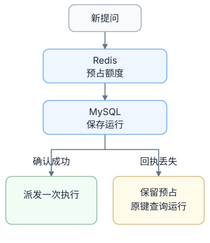
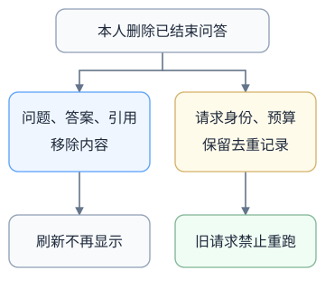

# 架构笔记 04｜让 Agent 运行状态与对话一起保存

给博客接上只读问答以后，页面可以通过事件流显示答案。但事件流只是一次连接：用户刷新页面，或者模型回答完成时连接刚好断开，应用仍然需要知道这次问题有没有受理、答案是否已经保存。

如果先把运行标为完成，再单独保存回答，中间失败就会留下“已完成但没有答案”的记录。反过来，先保存回答再更新状态，也可能让页面一直显示运行中，重试时又写入第二条答案。这里把运行账本放回 MySQL，并让它与已有对话历史共用一次事务。

下面说明的是已经在本地实现并测试的存储与控制边界。固定 SDK、正式问答 API 与临时 MySQL、Redis、MongoDB 已在隔离环境连通，来源回执和最终答案经过同一套应用接口。本篇所述控制场景使用合成模型响应与文章数据；后续官方模型的输入计数、预算与四题组合验证见[架构笔记05](2026-11-16-agent-model-budget.md)。现有本地页面尚未切换，人工语义与部署验收仍需继续完成。

## 一、先把受理问题这件事保存下来 {#atomic-admission}

一次提问需要同时留下三项内容：这段对话属于谁、用户问了什么、应用受理了哪一次运行。如果只有其中一部分成功，刷新后的历史就很难解释。

这里让运行服务开启事务，先检查当前账户并锁定它，再检查同一账户是否已经提交过这个请求。没有重复记录时，调用 AI 模块的历史接口创建对话和第一条用户消息，最后插入运行记录，一起提交。

**共用事务要共用数据库连接**。仅仅把两个服务调用放在同一个函数里并不够：如果历史接口自己从连接池取连接并提交，外层事务失败时，先前保存的问题仍然会留下。因此历史接口只使用调用方传入的事务对象，不自行提交；运行服务决定整体何时提交或回滚。

锁定账户还有一个作用：同一用户的两个并发请求会按顺序检查幂等键，避免都看见“还没有记录”，随后各建一段对话。不同用户可以使用相同的请求键，互不占用对方的运行。

同一个键还要绑定规范化后的问题。重复点击同一道问题时返回原运行；换了问题却复用旧键时明确报冲突，不能把新问题悄悄接到旧答案上。退出后重新建立的会话也不能借旧键找回上一段会话中的私有运行。

运行保存之前，还需要预占限额，避免并发点击同时启动多份工作。这里先查询已有运行，再用 Redis 脚本一起检查分钟次数和并发槽；已有记录不重复扣额。Redis 保证脚本执行期间不会穿插其他命令，但这只覆盖 Redis 内部，不能把随后保存 MySQL 记录也算进同一事务。[官方脚本说明](https://redis.io/docs/latest/develop/programmability/eval-intro/)明确了这项原子性边界。

因此，**不知道提交是否成功时，不能退款后自动重试**。如果额度已经预占，但数据库成功回执丢失，应用保留预占，等待它到期；如果数据库已经保存运行，后续用原请求键仍可找回。同一预占再次到达时只报告等待，不重新交出执行权。只有能确认尚未开始执行，或执行进程已经停止，才提前释放并发槽；分钟次数不退还。代价是短暂故障可能暂时占住额度，但不会因为猜测失败而重复启动任务。

## 二、完成状态跟随答案一起提交 {#atomic-completion}

模型返回文本后，运行服务先检查它属于哪一次执行、哪一个根会话、根请求和根回合，确认运行没有取消或过期。根请求使用 SDK 为用户消息分配的持久回执，再与实际进入根回合的用户消息核对，不能只取最后一条助手消息就当成本次结果。来源的读取与交付检查仍属于网关，模型自报“已完成”不能直接成为数据库事实。

通过这些检查后，再开启完成事务：锁定运行和对应对话，由 AI 模块写入最终消息，重新检查时限，最后把运行改为完成并保存结果摘要。只有这次提交成功，应用才有依据向页面报告成功。

| 失败位置 | 应保留的结果 |
| --- | --- |
| 最终消息写入失败 | 运行不变为完成，不留下半条答案 |
| 消息已写入、运行更新失败 | 消息随同一事务回滚 |
| 数据已提交、成功回执丢失 | 用原运行重新查询，得到已经保存的答案 |
| 同一完成通知重复到达 | 摘要相同则返回原结果，不再追加消息 |
| 同一执行给出不同最终内容 | 明确报冲突，不覆盖先前结果 |

这里的幂等只能避免同一结果重复落库，不能保证模型在分布式系统中“恰好执行一次”。例如派发请求已经送达，控制端却没收到确认，重新派发可能启动第二份模型任务。

因此控制端先在数据库中领取运行，保存本次执行标识、租约和凭据摘要，提交成功后才发送启动请求。**启动确认丢失时，只查询原执行，不重新发送启动请求**。查询能确认原执行仍在运行，就继续等待它的合法结果；仍然无法确认时，先把运行记为中断，再发送取消。执行端自报完成也不能直接改写数据库，答案仍须经过来源检查与完成事务。

这套控制路径已用可控的执行端验证确认丢失、重复派发和取消顺序，并在临时 MySQL 中检查发送前已经领取、取消前已经中断；它不等于真实执行进程的全部故障验收。若数据库本身无法确认终态，就明确保留“无法确认”，尽力停止原执行，再由租约对账收敛，不能报告已经成功取消。用户重新提问需要新的请求键。

## 三、取消和失联也需要终态 {#terminal-races}

用户点击停止时，模型可能恰好已经开始返回最终答案。只在前端隐藏文字，或者只向进程发送一个取消信号，都不能决定数据库最终保存什么。

这里让取消与完成竞争同一条运行记录的锁。先提交的合法终态生效：取消先成功，迟到答案不能再写入历史；完成先成功，之后的停止操作也不会把已保存答案改成取消。数据库结果确定之后，编排层再负责撤销凭据和回收进程。另一条控制链也可能先结束同一次运行，因此监控读到取消或中断后仍须通知执行端停止，不能只移除本地监控记录。停止请求本身也可能失败；数据库终态负责拒绝后续调用，进程是否退出仍要单独确认。

**控制器退出不等于执行进程已经回收**。执行程序有自己的进程组，强制结束控制器后，它仍可能继续运行，工作目录也仍然存在。因此正常停止要等执行进程组消失，再清理工作目录；控制器意外退出时，测试宿主按事先登记的进程记录独立回收遗留组。停止无法确认时，应用保留并发预占，不把“已经记为中断”当成资源已经释放。这项本地回收验证不能代替生产环境的进程隔离与自动恢复验收。

回收过程还需要保留第一次失败。比如，第一次检查进程组时无法确认权限，稍后再次停止才确认组已消失；如果只保存最后的“已回收”，就无法解释为什么前一次请求超时。反过来，只保留第一次失败，也会让后续处理者误以为资源一直没有释放。这里将“曾经未确认”和“后来确认回收”分别记录，后一次成功不会改写前一次观察。

**诊断也有自己的数据边界**：

1. **只记录定位所需的阶段与类别**。可以区分检查权限、发送停止信号、组仍存在和目录删除；不把问题、文章正文、凭据或原始异常文本一起复制到日志。
2. **保留首次失败并限制数量**。连续失败不会无限追加记录，后续确认回收也有独立位置。若日志只保存了一部分，要明确标记不完整，不能把缺少记录解释成从未失败。
3. **记录失败不能代替回收判断**。写诊断失败时仍要尝试停止进程和关闭其他资源；权限拒绝也不能当成进程消失。只有回收得到确认，才按原规则释放占用。

停止控制器的信号也可能多次到达。测试宿主按层关闭多个资源时，如果内层恢复了旧信号处理器，第二次停止信号就可能打断外层尚未完成的回收。因此这些层共享第一次中断的状态，后续信号不再重新抛出中断；在进程登记和资源关闭的临界区，第一次信号也延后处理。资源确认回收后仍报告中断，清理本身出错则保留错误，不能把延期处理变成成功退出。

这些记录能帮助下一次复现定位失败发生在哪里，但不能反推没有足够日志的旧故障。当前本地已有回收失败尚未完整定因，后续一次串行测试通过，也不能替之前的失败补上原因。

停止请求甚至可能先于启动到达：原启动请求仍在网络中等待，另一条控制链已经通知执行端取消。如果执行端看到“还没有这个任务”就直接忽略，迟到启动仍会产生一份已被撤权的工作。因此，即使尚未见过启动，也要先保存取消记录，再确认收到；同一次执行的迟到启动必须命中这份记录并拒绝。

**取消记录需要跨进程重启保留**。这里让执行端只保存执行身份、请求摘要与状态，不复制问题、正文或凭据；启动前先保存记录，重复请求只能查到原观察，不能重新创建进程。这份记录负责本机启动去重与回收，应用的最终运行状态仍由 MySQL 决定。记录数量同样有界，不能为了接受新任务而悄悄逐出仍可能收到迟到请求的记录。

运行详情也不能无限堆积，但**删除详情不等于允许重跑**。这里把已经确认结束的执行详情与禁止重跑的身份摘要分开处理：详情达到本地设定的三十天留存期后可以清理，身份摘要继续保留。即使有人换了截止时间或执行标识，再发送同一个运行身份，也不能重新获得启动许可。

清理需要满足三个条件：

1. **确实结束且没有在途操作**。进程回收未确认、启动或停止尚未返回时，不能只因记录已有终态就释放容量。未知孤儿继续保留，离线工具也不会猜测它已经退出。
2. **先保存禁止重跑的依据**。先持久保存身份摘要和目录格式标记，确认成功以后才删除详情。否则，在旧格式迁移途中删掉最后一份新记录，再丢失索引，目录可能被误当成空的旧数据重新启用。保存或删除确认不明时继续保留独占锁，不报告已经清理成功。
3. **有可信的留存时间**。新记录使用控制器保存的时间并考虑原截止时间；没有截止时间的取消记录额外保留启动有效窗口。旧格式没有可靠年龄时，从迁移时刻重新计算，不把文件修改时间当依据。目录还保存不回退的时间下界，系统时间回退时拒绝继续受理，不能借回退恢复旧请求。

身份摘要也有固定容量，满后停止新准入，查询与取消仍可使用；不能清空屏障后继续沿用旧目录。离线工具先预览、再显式执行，同样受独占锁保护，遇到既有控制器锁就拒绝，不会因为某个进程编号看似消失便接管目录。这项清理只针对执行端观察元数据，用户对话、应用运行账本和未知进程的恢复各有独立规则。

重启后的记录仍显示正在执行时，新的控制器不能凭空恢复原来的进程句柄，只能标为中断并保留“回收未确认”的状态。即使测试宿主后来确实清理了自己的遗留进程，执行端也不能仅从锁文件推导出这份外部确认，因此继续拒绝新任务，停止请求也不能返回已回收。代价是需要独立的宿主恢复流程；直接删锁再启动，无法解决缺少回收依据的问题。

已经确认完成并保存的记录则不同：恢复后，相同请求可以返回原来的完成状态，但不会再次执行；修改截止时间也不能让同一身份复活。本地故障测试只在自己创建的进程组全部消失后，显式处理测试目录的旧锁，再分别检查这两种恢复结果。这验证了持久状态的分界，尚未提供生产环境处理未知锁或未知进程的授权流程。

失联则由租约处理。运行被领取后拥有短租约，执行方需要在租约仍有效时续期，而且不能越过整次运行的截止时间。过期以后，即使旧执行方恢复连接，也不能通过一次心跳把自己重新变成活跃运行。

对账时需要区分两种情况：

1. **尚未领取就过期**。没有开始执行，可以记为受理超时。
2. **已经领取但租约失效**。是否执行到哪里已经无法可靠确认，记为中断，不自动重放模型任务。

这种处理会让某些网络故障以明确失败结束，但不会为了让页面持续转圈而悄悄重复执行。用户能从保存的状态判断是否需要重新提问。

## 四、工具返回了正文，还要确认交付 {#source-delivery}

来源记录也会遇到“写入了一半”的问题。应用已经从数据库读出文章并保存引用信息，不代表执行方收到了完整响应：连接可能在返回中途断开。如果此时就允许引用，记录只能证明文章被查询过，不能证明这次运行拿到了它。

这里把来源分成准备和已交付两个状态：

1. **读取前先占用预算**。同一次工具调用只扣一次次数，失败也不返还；结果返回前，再按完整响应的 UTF-8 字节数检查累计预算，连同调用标识、来源标识和摘要一起计算，避免正文不大、外层包装却不断膨胀。
2. **读完先记为准备完成**。来源表只保存文章与片段的摘要、标题和读取时间，不复制完整正文。搜索候选不生成可引用来源，实际读取正文才生成独立的来源标识。
3. **收到匹配回执后再交付**。可信工具适配器核对完整响应，再回传这次调用的摘要；应用把调用和来源一起改为已交付。重复同一回执不重复处理，摘要不匹配则拒绝。

最终写答案时，运行服务从本次已交付的来源集合中恢复文章，再读取当前公开正文核对完整快照与片段摘要。文章已撤回、内容变化或无法确认时，不接受旧引用完成回答；链接也由应用按站点地址生成。模型没有有效来源时，只能得到固定的未找到结果，不能借一个看似正常的 URL 补上引用。

完整工具响应只保留在有界的临时内存缓存中，用于同一调用的重复传输。缓存丢失时，这个调用会明确返回不可重放，不能重新读取一份可能已变化的文章，再把新内容当成旧响应。这样会让个别故障需要由运行控制层结束或中断，但不会让同一个调用标识对应两份不同正文。

这些检查能确认受信任适配器的交付链路，不证明模型已经理解文章。文章的公开状态与正文还分布在不同存储中，复核也不是不可变版本快照，不能据此承诺提交瞬间内容绝不改变。

## 五、复用历史表时保留聊天边界 {#history-isolation}

正式问答复用现有 AI 历史表，可以让问题、答案和运行状态在一个数据库事务中提交。不过，普通聊天原本支持追加和编辑消息，不能因此允许它修改 Agent 已验证的回答。

这里给 Agent 对话分配独立的 ID 命名空间，由运行记录保存场景和引擎信息；普通聊天的列表、读取、编辑、追加和反馈入口都排除这类对话。这样不用为了识别 Agent 会话，先要求所有旧数据库增加一个场景字段，旧聊天仍可使用原有表结构。

刷新后的恢复也通过 AI 模块读取已保存问答，并检查它们与运行记录的摘要是否一致。查询期间锁定同一条运行记录，使完成事务不能插在“读取运行状态”和“读取答案”之间，否则可能看到旧的运行中状态与新答案，反而把成功误判为异常。引用链接还要重查文章当前是否公开、内容是否一致；文章撤回、变化或读取失败时隐藏链接。已经展示过的纯文本无法因此收回。

需要注意，**检查请求里的字符串不等于检查数据库实际匹配的记录**。MySQL 的部分排序规则会忽略大小写和重音差异，应用里的前缀判断与数据库的相等比较可能产生不同结果。[官方排序规则说明](https://dev.mysql.com/doc/refman/8.0/en/charset-collation-names.html)解释了这些后缀的含义。因此隔离检查还要放到实际行的查询条件中，并对取回的真实 ID 再验证，不能只在路由入口比较一次字符串。

这条隔离边界先用带重音折叠的比较器验证，后续又在临时 MySQL 中检查实际排序规则。删除场景还构造了折叠后相等、字节不同的消息关联，确认只移除本次问答。这些测试覆盖的是具体比较情况，不能据此代表 MySQL 的全部排序规则。

历史还需要有明确的删除入口。普通聊天不能修改 Agent 对话，并不意味着用户只能永久保留每次提问。这里将历史删除交给运行服务：只允许当前会话的本人删除已结束问答，处理中则先要求停止，避免把“内容已删”误认为执行进程已经退出。

**删除历史不等于删除请求已经执行过的事实**。问题、答案、对话标题、引用与调用详情在同一事务中移除，运行账本仍保留原请求的身份摘要、终态和累计预算。刷新后这段问答不再返回，重复删除可以成功；再次提交原请求仍被拒绝，不能借删除退还额度或重新访问模型。迟到的完成通知也失去原凭据权限，不能把回答重新写回来。

删除与完成、历史读取共用同一条运行记录的锁。先完成的事务提交后，删除才清理完整问答；删除先提交后，后来的读取只能得到不存在。清理消息与反馈时，还要按真实对话标识精确匹配，避免大小写或重音折叠把其他内容一并命中。任一步失败就回滚，成功回执丢失则用原运行重复确认。

永久保留去重记录，也需要限制总量。分钟次数和并发只能控制速率，运行身份仍会长期累积。当前正式问答入口将持久运行身份限制为 8192 条，包含处理中、已结束和已删除历史的记录。**达到上限时停止新受理，不清空旧身份**。这个数是本地验证采用的保守边界，仍需结合生产存储测量；它不等于整个数据库的字节上限。

剩余额度由 MySQL 持久计数，与问题和运行记录一起提交。不同账户争抢最后一个位置时，也要竞争同一个计数锁，不能各自在内存里看见“还剩一个”就同时启动。受理事务失败，计数和历史一起回滚；提交回执丢失，按原请求查回原运行，不再扣一次。停止执行或删除内容都不会归还这个持久位置，原来的分钟次数与并发槽仍按各自规则处理。

旧库初始化不能因为新增计数表是空的，就把已有身份当作不存在。这里只读取最多比上限多一条的身份，已经足够判断能否继续受理；若旧记录本来就超过上限，保留它们并拒绝新增。已知满额时不再预占新的分钟或并发额度，既有问答的读取、停止与删除继续可用；预检后才发生容量竞争的请求则只释放未启动的并发占用，分钟次数不退。

账号停用是另一项操作。现有管理入口把账号设为停用后，旧会话重验会拒绝读取、删除及迟到回调，但历史仍保留；它不会自动变成全账号物理清理。去重记录也仍与账户有关，**不能将这项历史删除称为账号匿名化或完整数据抹除**。历史默认保留至用户显式删除，备份、日志及全账号清理需要另外确定范围。

## 六、重查权限还要读到当前状态 {#current-authorization}

把授权检查放回同一条数据库连接，可以避免嵌套借连接，但还需要确认它读到什么。比如运行开始时管理员角色有效，另一个事务随后提交了撤销；完成答案前再次查询，如果仍然沿用第一次的一致性快照，就可能继续看见旧角色。

这里让正式运行事务单独使用 READ COMMITTED，账户和角色在同一条非锁定查询中读取，后续检查能够观察已经提交的变化。运行记录仍通过行锁串行化取消和完成，不再反向锁用户行。普通聊天和其他旧业务保留原默认隔离，单次运行的设置不留到连接池的下一次请求。[MySQL 的隔离级别说明](https://dev.mysql.com/doc/refman/8.4/en/innodb-transaction-isolation-levels.html)介绍了两种快照行为的区别。

来源重读也要遵守同样的连接边界。只有两个连接时，如果请求 A 持有运行锁，请求 B 占着另一个连接等待这个锁，而 A 又要另借连接查询账户或文章，就会形成等待链。这里把当前事务继续传给账户查询和文章元数据查询，让 A 用手中的连接完成检查，而不用等待第三个连接出现。

这条路径已在一次性 MySQL 实例中验证：先确认 B 已进入实际锁等待，再让 A 完成授权和来源重读；另在答案事务中途提交账号禁用，确认后续检查会拒绝保存答案。测试还复用了同一个物理连接，验证空事务和首条查询前失败都不会改变下一次旧业务读取的隔离行为。

数据库短暂不可用时，连接池还要保留恢复的机会。旧实现丢弃失效连接后立即补建，如果补建也失败，这个可借位置就消失了；所有位置耗尽以后，即使数据库重新启动，后续请求仍只会等待一个永远不会再填充的空池。这里把可借位置与具体连接分开：确认关闭失效连接后保留空位，下一次独立请求才有机会在原位置建立新连接，并继续限制物理连接总数。

**恢复连接不会重放已经发出的事务**。原查询或提交失败仍返回给调用方，数据库恢复后按原运行或请求键查询结果；不能因为换到了健康连接，就再次发送同一段写入。连接探活也禁用驱动内部的隐式重连，物理会话的建立与登记仍由连接池管理，事务不会在中途悄悄换到另一条连接。

关闭过程同样需要确认归属。连接池先拒绝新借用，已经借出的事务仍由原调用方结束，归还时再关闭；无法确认关闭的连接继续占据原位置，不能一边留下旧连接，一边增加新连接。批量清理遇到一次中断时，仍尝试处理其他连接，收好状态后再传播中断，避免表面上已经关闭、内部却失去追踪。

需要注意，这解决的是数据库内的观察与连接问题。登录会话仍需通过已有 JWT/Redis 规则重验，角色和会话不属于跨系统原子快照。运行中的令牌绑定只留在易失内存，进程重启后不会从一串数据库摘要还原出登录身份。

## 七、事务测试通过之后还要验证什么 {#verification-boundary}

这次使用真实的临时 SQLite 连接检查事务回滚和并发结果，包括重复受理、重复领取、取消与完成竞争、写答案途中超时，以及提交成功后回执丢失的恢复。故障注入放在答案已经插入、运行尚未更新的位置，确认整个事务失败时，历史里不会多出一条回答。

SQLite 测试适配会更强地串行化写操作，不能据此判断 InnoDB 行锁已经正确。后续已在临时 MySQL 8.4.13 中验证建表、并发受理与领取、事务回滚、权限当前读和上述池等待场景。正式 API 组合还使用一次性 Redis 验证了真实会话、重复请求不再扣额、断流取消和新应用实例恢复；恢复与完成的竞争测试先确认数据库实际进入锁等待，再检查状态与问答一致。

数据库进程本身也需要单独验证。本地故障矩阵在同一个一次性 MySQL 8.4.13 实例上，每次强制终止进程，确认退出后再从原数据目录启动，并核对实例身份。受理和完成事务若尚未提交，恢复后不会留下半段对话或“完成但无答案”；事务已经提交，再模拟客户端丢失成功回执，恢复后仍只有原运行和一条最终答案。

模型调用的预占也采用同样的提交边界。调用次数刚保存就失联时，不进入输入计数；输入预占刚保存就失联时，不发送生成请求；结果用量已保存后失联时，不再次访问模型。三处故障都实际重启数据库，再检查次数、输入预算与用量，过期后只收敛为中断。这里的模型与文章仍为合成数据，提交回执丢失是放在真实提交之后的可控注入；**强杀数据库进程不等于主机断电验收**。

旧结构升级还有另一种边界：一次修改失败，不代表之前的建表或补列都被撤销。因此迁移前先检查完整结构，遇到不兼容的列、索引或外键就停止；中途只完成部分修改时，重新检查剩余差异，再补缺项。合成旧结构用于核对已有记录保持和重复执行收敛，不能替代目标业务库的真实结构、数据与备份恢复演练。

再往外连接时，固定 SDK 通过双向证书认证访问真实监听器，工具经博客模块查询 MySQL 元数据与 MongoDB 正文，引用编号取自实际交付的工具结果。整条链路验证了成功后刷新、真实连接断开、会话撤销、提交前撤回文章，以及控制进程崩溃后的中断与测试资源回收。模型响应仍为合成输入，所以这能证明应用如何保存和拒绝结果，不能证明模型理解文章的质量。接入正式入口之前，还需要完成：

1. **MySQL 实例验收**：本地已补齐同数据目录的进程崩溃恢复与提交回执丢失矩阵；仍需对目标业务库的实际结构、数据和备份恢复做迁移演练，不能把合成旧结构或一次性新库当成全部验收。
2. **真实模型验收**：官方路径的完整输入计数、持久预算及固定四题组合已在本地验证，来源与端到端语义经过独立 agent 复核；人工语义验收和更完整的故障与问题覆盖仍待完成。合成响应只证明协议路径，四个样本也不能代表一般准确率。
3. **运行环境验收**：确认 Worker 的隔离、资源限制、凭据撤销与进程清理均有效。

运行环境还要分清两层。在开发机上准备临时 Linux guest，可以实际检查内核的 cgroup 和用户、挂载、PID、网络命名空间，再在其中重跑取消、去重和恢复协议。guest 只接收明确选择的代码与合成测试，不分享宿主目录或业务凭据；这样才能让一次故障实验的影响留在自己创建的环境里。

**虚拟机的边界不等于单次任务的边界**。给整个 guest 两 GiB 内存，并没有证明每个任务都受到独立内存和进程数限制；不给 guest 网卡，也没有验证“允许合法 API，同时拒绝任意外网”的策略。后续仍需对实际 Worker 分别触发超额、跨任务读取和未批准地址访问，核对允许与拒绝两条路径，不能仅凭 Linux 能启动或一组协议测试通过就放行。

任务内部还会创建后代进程。单靠启动时的进程组发出停止信号，可能漏掉另建会话的后代；因此 Linux 启动器需要把可信启动包装器及其后代先纳入本次独立的 cgroup，再执行任务。内存和进程数限制作用于整棵树，停止也以整棵树为单位；确认其中已无进程、原进程组消失并移除资源组后，才删除工作目录。**进程组消失和任务资源已回收是两项检查**。

这份所有权也要覆盖启动失败。创建隔离资源之后，后面的准备、限额核对或执行程序都可能失败；如果清理仍有错误，就应保留可重试的回收句柄与占用槽，不能因为“程序还没启动”就当作没有资源需要处理。文件边界同样要核对两侧：本次目录应能写入，其他任务目录应不可见，固定运行依赖应保持只读。原生内核的超额事件和这些允许、拒绝结果，要在同一条启动路径中验证。

事务负责让已经决定保存的数据保持一致；它不会代替来源核验和当前权限检查。把这些职责分别完成，再连接起来，刷新页面看到的“完成”才有可追溯的保存依据。
