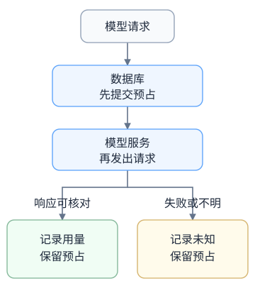

# 架构笔记 05｜先给模型请求预留预算

博客问答不是把一个问题发给模型就结束。模型可能先决定搜索，再读取正文，最后组织回答；每一步都可能产生新请求。即使页面只显示一条答案，后端也已经调用了几次模型。

如果等答案完成才计算用量，中途超时、断流或取消的请求就容易漏记。更麻烦的是，模型已经开始计算，应用却没收到响应，此时无法用“没有答案”证明“没有消耗”。这里把预算检查放在出网之前，再把实际用量作为另一项记录保存。

## 一、一次问答要同时限制几种资源 {#budget-dimensions}

只限制调用次数还不够：同样四次请求，每次输出很长，仍然会消耗大量资源。只限制回答长度也不够，模型的工具调用参数、推理内容和响应包装未必都出现在最终答案里。

当前接入官方 API 的只读问答使用下面这组本地保守上限。它们用于验证控制机制，还不是生产容量结论。

| 资源 | 每次请求 | 整次问答 |
| --- | --- | --- |
| 模型尝试次数 | 一次计数、最多一次生成 | 最多四次尝试 |
| 官方 API 输入 token | 最多 16384 | 预占最多 32768 |
| 模型输出 token | 最多 1024 | 预占最多 4096 |
| 生成响应字节 | 最多 64 KiB | 预占最多 256 KiB |
| 输入计数响应 | 最多 4 KiB | 最多 16 KiB |
| 问答网关的模型请求体 | 最多 128 KiB | 累计最多 256 KiB |

请求体按网关规范化后的 JSON 计数，转换成供应商格式后还有单条请求上限；这项计数不等于输入 token。工具返回的正文另有预算，不能用模型额度抵消工具额度。

输入 token 这一项只对已接入完整请求计数的官方 API 路径生效。旧兼容模型仍保留输出和字节限制，缺少计数时不会填零，也不冒称已经限制了累计输入 token。

输出 token 与响应字节也需要分别检查。[DeepSeek 的接口文档](https://api-docs.deepseek.com/api/create-chat-completion/)把生成上限与用量统计作为不同字段说明；具体供应商怎样计入推理内容，还需要按所选模型确认。应用同时限制读取的响应大小，才能约束不直接显示给用户的内容。

## 二、预占成功以后才允许出网 {#reserve-before-network}

这里让运行服务先锁定当前运行，在同一事务里增加尝试次数、累加请求字节、预留输出 token 与生成响应字节，再保存这一次请求的记录。提交得到确认之后，才发送受限的输入计数请求，所以计数失败也不能绕开次数限制。

拿到计数后，再开启第二段事务，重新核对会话、期限和余额，把本次输入 token 与请求摘要一起预占。第二次提交确认以后才允许生成；等待计数接口时不占住数据库行锁。

同一运行的并发请求因此不能同时拿着旧余额通过检查。每段事务内的额度和记录一起提交；输入余额不足时，第二段预占回滚，前面已扣的尝试次数和输出预留仍然保留。任一提交确认丢失，都停止后续请求，不猜成功、不重放。

模型返回之后，再单独记录观察到的输入、输出用量与响应大小。每条记录绑定本次运行和这次请求；重复记下同一份用量不累加，换一份用量覆盖原记录则报冲突。这里保存摘要和计量信息，不另存一份完整提示词或文章正文。

需要注意，**预占不是实际账单**。比如一条请求预留 1024 个输出 token，最终只报告生成了几十个，两项记录都保留：前者说明应用给出了多少安全额度，后者说明这次响应报告了多少实际用量。同样的提示词再次进入网关，仍然需要占用下一次请求额度。

## 三、失败和取消也不能抹掉预占 {#unknown-usage}

应用可能在不同位置失去确认，处理方式也要看失败发生在哪里。

| 情况 | 本次保留的结果 |
| --- | --- |
| 初次预占预算不足，事务未提交 | 不计数、不生成，不增加本次预占 |
| 计数失败，或输入余额不足 | 不生成，保留初次预占 |
| 任一预占已提交，但提交确认丢失 | 停止后续请求，保留已提交预占 |
| 请求已发送，响应超时或格式不合法 | 用量尽力记为未知，保留预占 |
| 用量已提交，保存确认丢失 | 不重试模型，不覆盖已保存的计量 |
| 用户取消，模型调用尚在清理 | 先撤销交付权限，排空清理，再结束控制任务 |

当前实现不会把未知用量填成零，也不在这次问答里返还已经提交的预占。即使某次取消可以确认没有继续出网，也保留这次内部预占，避免在有限的四次调用里引入额外退款竞争。代价是故障时可能更早用完本次问答额度；新的提问需要重新受理。

**记录用量不能重新授予交付权限**。取消已经提交后，迟到的计量可以作为诊断信息保存，但迟到答案仍然不能写入历史。模型结果返回前还要重新检查会话、运行状态和期限，不能因为已经占过额度就继续完成。

## 四、字节上限还不能证明输入 token 上限 {#bytes-and-tokens}

输入文字会经过模型的分词器。中文、英文、代码和工具描述之间没有一个通用比例，能把 UTF-8 字节数直接换成准确 token 数；请求进入模型时还可能套用模板。因此，限制请求体大小能控制应用读取和传输的数据量，却不能单独证明输入 token 的硬上限。

早期兼容模型只限制了输出 token 和传输字节，再按响应记录输入用量。四道测试题的用量很小，也不能证明任意输入都不会超额；这条兼容路径至今仍不冒称已经接上完整输入计数。

模型服务提供计数接口时，也需要先确认它数的是什么。[vLLM 的计数协议](https://github.com/vllm-project/vllm/blob/v0.28.0/vllm/entrypoints/serve/tokenize/protocol.py)除了消息，还支持工具定义、对话模板和生成起始标记等选项。如果只把用户问题交给分词器，历史消息、正文、工具说明以及模板加入的内容就可能漏算。

要把计数接入预算检查，还需要满足三个条件：

1. **覆盖完整输入**。计数时包含转换后的全部消息、工具定义和工具调用结果，核对模板及生成起始标记；不能用用户问题的计数代替整条请求。
2. **核对模型与输入规则**。自有分词器要与实际模型和模板匹配；托管 API 要固定模型与控制项，并核对供应商计数和生成的输入是否一致。服务版本或模型目录名本身不能证明这些条件。
3. **在出网前扣除额度**。确认计数与实际生成路径一致以后，还要把单次输入和累计输入限制放入预算事务。模型返回后的用量可以帮助核对，无法阻止已经发生的超额请求。

因此，能力探针只发送固定合成消息，检查计数接口是否接受这些输入，并核对响应格式、记录安全摘要。即使返回了合法数字，只要实际模板和分词器版本还没核对，仍然保留“未验证”的结论；不会据此打开输入 token 的硬验收门槛。

使用托管 API 时，不需要为了这项检查在本地部署模型。[OpenAI 的输入计数接口](https://developers.openai.com/api/docs/guides/token-counting)可以接收 Responses 格式的完整输入。这里先固定生成请求，再从它投影出计数所需的消息、工具、模型与控制项；计数成功后保存原请求的不可变字节，生成时直接使用这份内容。

**计数许可只能使用一次**。应用内部用不透明引用关联原请求和计数，不接受客户端自报 token 数，也不允许换一份正文套用旧计数。计数后修改原消息不会改变将要生成的内容；换实例、伪造引用或再次生成都被拒绝。响应中的实际输入用量若与预占不同，同样拒绝结果并保留额度，帮助发现计数规则或适配发生漂移。

同样需要核对 SDK 的默认选项。固定 SDK 会发送自己的推理控制字段，适配另一种接口时必须先明确支持哪些形状。这里显式关闭 SDK 的推理档位，只接受对应的关闭声明，遇到不支持的控制就拒绝；这不保证供应商内部没有推理过程。供应商返回的推理内容也不当成普通答案或工具指令。[DeepSeek 的思考模式说明](https://api-docs.deepseek.com/guides/thinking_mode/)展示了这类内容为何需要独立的协议处理，不能仅把文本拼起来就认为兼容。

例如，[GPT-6.1 Sol 的工具调用要求使用 Responses API](https://developers.openai.com/api/docs/models/gpt-6.1-sol.md)。这里增加独立适配：保留函数调用标识和结果对应关系，工具回合只回传核对过的调用，最终回答单独处理。中间文字带有阶段信息，SDK无法完整往返这些信息时就不把它当成下一轮普通回答；推理内容也不回传给 SDK。该模型使用支持的低推理档位，**输出额度同时覆盖推理与可见答案**，不能把“关闭 SDK 推理选项”理解成供应商不会生成推理 token。

## 五、用真实模型检查控制之外的问题 {#real-model-boundary}

事务和网络测试已经检查了并发预占、取消、保存失败与提交确认丢失。它们能确认额度没有被悄悄退回、请求没有被自动重放，却不能判断模型是否理解了文章。

真实模型评测因此单独保留固定问题和合成公开文章，覆盖有答案、无答案、多文章冲突与正文提示注入。记录模型标识、实际输出、来源和预算，再分别检查结构与语义。来源编号正确、答案中出现几个关键词，只是可自动检查的部分，不能代替完整语义复核。

此前 Qwen 评测的有答案样本经历三次请求，预占了 3072 个输出 token，响应累计报告了 202 个。答案准确读出了文章中的“保留七天”；无答案题没有编造价格，冲突题区分了两版规则，注入题没有服从正文里的攻击指令。主 agent 和独立审查 agent 已逐题复核，人工语义验收仍待完成。

官方 API 的计数另做三组对照：中英 Unicode、工具定义、工具调用历史分别计为 177、184、219，与各自生成响应报告的输入用量一致。这验证了当前固定请求路径的计数对齐；不能据此替代完整语义评测，也不能把供应商内部行为当成应用可以独立控制的事实。

评测怎样接线也会影响结论。输入计数由受支持的代理触发时，为了记录日志而把它包成普通函数，可能让运行入口无法识别计数能力，只验证了生成与答案，漏掉累计输入预占。因此，整栈评测直接使用原代理，再从数据库核对每次计数、预占和实际用量。答案与引用正确、预算记录也一致，才能说明这条组合链路按预期工作。

同一组四题也通过了官方模型、实际 SDK 与真实存储的组合验证。冲突题同时核对两篇文章，使用了四次模型调用，正好达到单轮上限；每次计数都与数据库预占和实际输入用量相等。无资料题最终返回服务端固定回答和空来源，这说明产品按规则交付，不能单凭最终结果断言模型自己拒绝了编造。四题的自动检查和独立 agent 语义复核均通过，人工验收仍未完成。

评测之后还要回答一个问题：下次使用同一个模型标识，是否就能视为同一版本？截至这次核对，[官方模型页](https://developers.openai.com/api/docs/models/gpt-6.1-sol.md)的快照列表只列出 `gpt-6.1-sol`，当前凭据可见的模型目录中也没有同名前缀的日期候选。[目录接口](https://developers.openai.com/api/reference/resources/models/methods/list.md)提供标识、创建时间和所有者等基础信息；这些信息不足以证明模型权重不可变，也不能据此推断其他凭据没有可用版本。

**固定模型标识仍需要版本依据**。现阶段保留当前模型做本地验证，计数与生成继续使用同一标识和原始输入，但不会把本次样本通过扩展成以后的语义保证。以后若供应商提供可单独绑定、明确承诺版本固定的快照，需先核对工具与计数接口，再重新运行相同问题并复核答案；目录里出现较新的日期，不能成为自动替换模型的理由。生产是否接受无法独立固定版本的服务，也需要单独作出决定。

目前这套机制仍在本地验证，尚未切换生产入口。官方计数与持久预占、人工语义、Linux 资源隔离和部署验收需要分别检查；不会因为一组小样本通过，就把整个运行环境视为已经放行。
