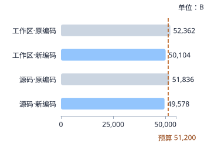

# 性能排查｜一次内联 PNG 的无损压缩

前端测试和构建已经完成，接下来的体积检查却仍然失败：18 份 CSS 资产合计为 52,362 字节 gzip，超过项目设定的 50 KiB，也就是 51,200 字节。

差额只有 1,162 字节，但直接提高预算无法解释它来自哪里。这次排查保留页面与样式行为，从已提交源码重新构建，再检查体积较大的样式资产，最终收拢到编辑器的十张内联鼠标指针。

## 一、先核对构建产物与源码范围 {#measure-built-css}

这里限制的是**每份构建后 CSS 分别 gzip，再累加的总量**，并非源码文件大小，也不是把所有样式拼成一份后再压缩。修改源码少了多少字节，不能直接当作最终节省。

工作区还包含其他未提交的页面与样式修改。为了区分影响，排查另外取已提交源码，使用同一项目 Node、Vite 生产模式和预算计算构建。这个对照得到 51,836 字节，仍超过预算。

这只能说明未提交改动不是唯一条件，不能据此把所有超额都归因于其中一份样式。继续按资产查看，编辑器路由的一份 CSS 达到 8,244 字节 gzip，其中包含十张 32×32 的内联 PNG。图片与普通样式混在同一个压缩结果里，需要进一步拆开核对。

## 二、保留内联，合并相等的颜色通道 {#merge-equal-channels}

这些指针以 Base64 放在样式中，原有做法是为了兼容编辑器的库打包。继续保留内联，可以沿用同一条装载路径和缓存边界；优化位置落在图片的编码方式。

逐像素检查发现，十张图的红、绿、蓝值都相等。例如一个像素的三个颜色分量都是 80，存三个 80 对表达这份灰度没有帮助。[PNG 规范的 RGB 合并规则](https://www.w3.org/TR/png-3/#4Concepts.RGB-merging)允许将这样的三个颜色通道合为一个灰度通道。这里保留原来的 8 位精度，再独立存储透明度。

**合并相同通道不会把彩图强行变成灰度图**。转换只在每个像素原本就满足条件时进行；只要出现不同的 RGB 值，就拒绝处理。指针边缘的半透明像素同样保留，色彩与物理尺寸信息也随原图留下。

图片外的语义还要分别核对：选择器对应哪个指针、鼠标热点位于图内哪个位置，以及图片不能使用时回退到什么光标。编码器只替换图片正文；随后必要的格式化通过浏览器样式规则再检查，避免把空白变化误判成行为变化。

## 三、用独立解码确认像素等价 {#verify-independent-decoding}

转换器能重新读回自己生成的图片，仍可能存在同一处编解码错误相互抵消。这里另外用浏览器原生图片解码和 Canvas 读取，以及 Apple ImageIO 解码，对每张原图与新图逐像素比较。

浏览器还分别比较透明、白、黑与棋盘格底色下的结果，检查透明边缘是否变化。十组图片在两套独立原生解码中均保持相同；浏览器中的十二条指针样式规则，在排除图片编码本身后也一致，热点与回退保持原值。编辑器库构建仍内联同样的十张新图。

**视觉相似不能代替逐像素比较**。截图适合发现明显异常，而编码是否保真、透明度是否丢失，需要独立解码后的数据支持。实际编辑器中再切换选择、拖动画布和矩形工具，检查图像资源与原生光标的使用路径。

## 四、回到同一套构建与预算 {#verify-build-budget}

十张 PNG 二进制合计从 7,893 降到 5,662 字节。编辑器路由 CSS 的 gzip 则从 8,244 降到 5,986 字节；两者的差值不同，因为 Base64、样式内容和 gzip 会一起影响最后的结果。

| 检查对象 | 原编码 | 新编码 |
| --- | --- | --- |
| 十张 PNG 二进制合计 | 7,893 B | 5,662 B |
| 编辑器路由 CSS gzip | 8,244 B | 5,986 B |

重新构建后，当前工作区 CSS gzip 总量降到 50,104 字节，已提交源码的对照则降到 49,578 字节。两组各减少 2,258 字节，均落在原有预算内；18 份 CSS 中有 17 份内容摘要保持不变，变化集中在编辑器路由样式。

这次没有测量首次绘制或网络延迟。得到的证据是同等像素下的构建体积减少，不能把字节节省直接换算成页面快了多少毫秒。50 KiB 也只是本项目的预算，不是通用的站点性能阈值。

体积检查通过后，后续门禁还发现了标签与重试按钮没有使用项目基础组件的问题。修正这两处后，修改后源码快照的完整 Web 检查通过；实际工作区另有未提交组件的 UI 检查尚未完成。**通过一项预算，还需要继续跑完后面的检查**。

## 五、把转换条件留给后续维护 {#retain-scope-checks}

维护入口默认只检查，显式写入时才替换资源；它限定当前十张指针、尺寸、位深与支持的 PNG 块，不接收任意上传图片。再次执行不会重复改写已处理资源。

1. **有颜色就拒绝合并**。未来指针加入彩色像素时，应重新选择编码方式，不能沿用当前条件强制转换。
2. **透明度与色彩信息一起验证**。尺寸相同、文件更小，都不足以证明显示一致。
3. **保存失败要区分发生位置**。原子替换前失败可以保留原文件；替换后的目录同步失败，文件可能已经更新，需要核对结果，不能承诺所有报错都等于未写入。

本次结果来自本地构建、原生解码和页面检查，稿件记录的是这份资源的等价改写。站点部署和其他未完成的检查继续按各自条件验收。
