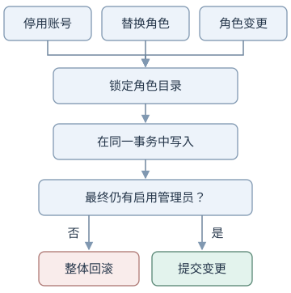

# 最后一名管理员，为什么要在事务里保护

管理页面允许停用用户，也允许修改角色。如果系统只有一名管理员，而这些操作没有共同的保护规则，一次正常的维护就可能让所有账号都失去管理权限。

首次检查 Sun World 的旧实现时，用户停用直接更新账号状态，角色修改和删除走各自的数据库方法；服务层的用户角色替换则先删除旧绑定，再逐条插入新绑定。已有用户停用和角色维护 HTTP 入口受管理员检查，角色替换尚无 HTTP 入口。入口检查只回答发起人现在能否操作，不能保证操作之后还有管理员。

下面的复现使用独立临时 MySQL 和合成账号，未修改现有业务库。**这里讨论的是防止启用管理员归零，不等于已经验证账号的登录凭据或人工恢复流程**。

## 一、同一个问题藏在不同入口里 {#withdrawal-paths}

原版本的临时库测试中，唯一启用管理员可以被停用，管理员角色也可以被改成普通角色或直接删除。删除角色后，用户与角色的绑定还留在关联表中，指向已经不存在的角色。

角色替换还有另一种失败：把某个用户改为重复的普通角色列表时，第一次插入成功，第二次触发唯一约束，方法返回失败。但旧管理员绑定早已删除，第一次普通角色插入也已提交。方法返回失败，并不意味着数据库保持原样。

因此修复需要同时解决两件事：**撤权完成后至少留下一名启用管理员，多个 SQL 步骤失败时整体回滚**。只给停用按钮加确认弹框，覆盖不到角色改名、删除和替换路径。

## 二、把会减少管理员的写入放进同一边界 {#shared-transaction}

当前判断沿用服务端已有规则：用户处于启用状态，并且至少绑定一个去除首尾空白、转为小写后等于 admin 的角色。角色可以有多个，重复绑定或多个管理员角色不会让同一个用户变得更可靠；禁用用户也不能充当剩余管理员。

事务开始后，先按主键顺序锁住现存角色目录，再执行本次修改。提交前重新锁读目录，按上述规则找到管理员角色，并检查是否仍有启用用户与它们绑定。检查失败时，账号状态、角色定义和关联表的改动一起回滚，接口返回冲突提示。

替换角色时，目标用户和全部目标角色要先存在，重复角色先去重，再在同一事务中删除旧绑定、插入新绑定。删除角色时，用户关联、资源关联和角色本身也一起处理，避免留下指向空对象的记录。

这里选择锁住整个角色目录，是因为当前目录规模很小，而且几条旧维护路径需要一个共同的数据库协调点。**锁覆盖的是这些会撤权的维护操作**；普通姓名、密码、角色名称和描述更新不会减少管理员，继续使用原来的更新路径。目录变大以后，应重新评估锁范围与维护吞吐。

## 三、先数一遍，仍然挡不住同时撤权 {#concurrent-withdrawals}

假设有甲、乙两名启用管理员。请求 A 要停用甲，请求 B 要移除乙的管理员角色。如果两边都在事务外先数一遍，两次检查都可能看到两名管理员，然后分别提交，最终一个也不剩。

共同的角色目录锁把这两个决定排出顺序。A 先取得锁，B 等待；A 停用甲后，仍有乙，允许提交。B 随后取得锁，在 READ COMMITTED 事务中读取新的已提交状态。此时再移除乙就会归零，因此整个替换回滚，乙保留管理员角色。

本地并发测试实际用了两个数据库连接：让第一个写入在持锁后暂停，确认第二个事务进入 InnoDB 锁等待，再释放第一个写入。最终第一个操作成功，第二个操作被保护规则拒绝。这里验证的是数据库中的真实交错，不能用两个依次执行的方法调用代替。

## 四、会话有效，还要检查初次认证时间 {#recent-primary-authentication}

事务保护了操作之后的数据状态，但还有一个不同的问题：持有活动会话的管理员，是否刚刚证明过自己的身份？独立临时 MySQL、Redis 与真实认证模块的测试中，初次登录已过去700秒、access 仍然有效的账号，原先仍可通过 HTTP 创建角色。

这里复用了账号关联已有的认证窗口，默认是初次认证后600秒，配置允许60至3600秒。账号创建和停用、角色创建修改删除与资源绑定、资源元数据创建修改删除，共9项管理写入增加这层检查。管理列表和详情继续按原管理员规则读取，不因为认证窗口过去就立即退出整个会话。

**普通刷新延长会话，不延长初次认证时间**。后端只读取同一活动 Cookie 中的签名证明，请求头、正文中的时间和用户 ID 都不能替代它。超过窗口时提示重新登录；重新完成已有密码登录后，才建立新的认证时间。现有客户端收到这个403提示时，也不会自动刷新并重放管理写请求。

修复时还发现，直接复用旧刷新方法仍有漏洞。它把原认证时间交给签发方法：空值会走“未指定时间”的分支，重新取当前时间；字符串和浮点数则会被转换成整数。这样，**刷新可能把原本不合格的证明转换成合格证明**。

这一复现使用的是已经签名、并且在 Redis 中仍有效的合成 token，不能据此认为普通客户端能够自行篡改签名字段。问题出在兼容流程重新解释了原有证明，而非跳过了签名校验。

现在只有原本有效的正整数时间可以原样继承，缺失、空值、布尔值、字符串、浮点数或超出未来偏差的时间，都继承为“没有近期证明”。普通旧会话仍可刷新，但不能因此恢复敏感维护。真实签名 access 和 refresh 都带异常值的测试，已核对刷新前拒绝、刷新成功但证明仍无效、刷新后继续拒绝，并确认业务表没有变化。

## 五、验证通过的范围与仍需保留的限制 {#verification-boundaries}

独立临时 MySQL 已验证最后管理员的四条撤权路径、多个和禁用管理员、带特殊空白的角色代码、重复角色去重、删除关联清理、SQL 失败回滚，以及单连接池下的调用。并发撤权除了核对最终结果，还检查了第二个事务确实在等待锁。

对于已经没有启用管理员的数据库，修复性写入只要最终建立了启用管理员，仍可提交；敏感维护如果结束时依旧没有管理员，则拒绝提交。这为受控恢复留下了数据层空间，但没有新增公开恢复接口。

使用这类保护时，还需要保留三个边界：

1. **所有撤权写入都要经过同一协议**。旧版本服务、外部 SQL 和人工数据库操作可以绕过应用层锁，不能混用后仍宣称不变量成立。
2. **有管理员角色不代表账号可恢复**。近期认证已覆盖上述9项维护操作，不能据此推导全部管理动作都完成迁移。真实账号的凭据、可授予范围、审计与实际恢复演练，仍需分别验证。
3. **数据库错误要完整失败**。锁等待超时、死锁或 SQL 错误不能被转换成部分成功；当前实现回滚并传播错误，不自动重试撤权操作。
