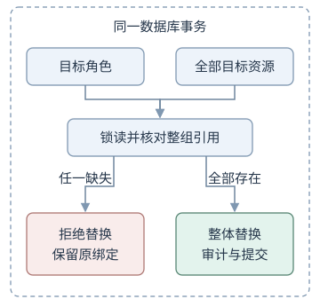

# 角色资源绑定返回成功，为什么还会留下失联关联

维护角色时，可以一次替换它关联的资源列表。用户通常会把“保存成功”理解为：角色存在，所选资源也存在，整组关联已经保存。

Sun World 的本地测试发现，原接口只要能够插入关联行，就会返回成功。使用已登录的合成管理员，把存在的角色绑定到不存在的资源，数据库仍保存了这条关联。这个问题出现在独立临时库中，尚未据此确认现有业务数据受到影响。

[前一篇管理员事务案例](2026-11-17-last-administrator-transaction.md)处理了最后管理员、当前授权和同事务审计。这里继续看另一个条件：**一组 SQL 可以完整提交，却同时保存一组失联引用**。

## 一、成功响应背后的关联行 {#orphan-binding-baseline}

复现库中，角色4和资源1、2存在，角色999和资源999不存在。原接口受管理员及近期认证检查保护，测试通过正常认证后发起请求，得到以下结果：

| 请求条件 | 原响应与实际写入 |
| --- | --- |
| 不存在的角色999绑定资源1 | 返回200，保存角色999与资源1的关联 |
| 角色4绑定不存在的资源999 | 返回200，保存角色4与资源999的关联 |
| 资源列表包含0或负数 | 返回200，照常保存该值 |
| 资源 ID 是布尔值或数字字符串 | 被转换成整数，再返回200 |
| 同一资源 ID 重复两次 | 第二次插入触发唯一约束，返回503，事务回滚 |

原方法已经有事务：先删除角色的旧关联，再逐条插入请求中的资源 ID，最后写审计并提交。但它没有在写前确认角色和整组资源都存在，关联表也没有替它完成这项检查。

因此这里要分别处理三个条件：输入是否表达了合法 ID、这些对象当前是否存在、整个替换是否一起成功。只补事务，仍然会完整保存不存在的引用；只补一次事务外查询，又会留下查询之后对象被删除的时间差。

## 二、先把输入变成确定的集合 {#strict-reference-set}

绑定列表现在只接受**严格的正整数资源 ID**。布尔值、浮点数、数字字符串、0和负数都直接拒绝，不再依靠转换猜测调用者想表达哪个资源。

上限也按实际资源表的有符号整数列设置。契约生成时曾发现，采用更宽的64位上限会在 OpenAPI 数值转换中舍入；收紧到实际列范围后，**接口描述与运行时检查使用同一个可精确表达的上界**。这没有扩充数据库 ID 类型。

资源关联表达的是集合。列表中的**重复 ID 按首次出现去重**，空列表表示清空当前角色的资源；原有最多500项的限制仍作用于传入列表，不能用大量重复项在去重后绕过它。普通客户端继续传整数数组即可。

服务端随后把规范化结果复制成不可变的参数集合，检查与写入都使用它。内部调用方即使再修改原始列表，也不能让服务检查一组对象、实际写入另一组对象。

## 三、先核对整组引用，再删除旧绑定 {#reference-check-transaction}

身份与权限检查仍先执行。无凭据、普通用户或认证过久的调用，在查询目标是否存在之前就被拒绝；请求正文中的角色或审计信息不能替代真实会话。

实际写事务沿原协议锁定操作者授权后，再锁读目标角色和全部资源。资源 ID 按主键顺序读取并持锁，任一对象缺失就统一返回404，**此时尚未删除旧绑定，也不追加变更审计**。即使列表为空，也要先确认目标角色存在。

例如角色4当前绑定资源2，请求改为资源1和999。资源1存在、999不存在，这组替换会被整体拒绝，原来的资源2仍然保留。不能先接受存在的部分，再把缺失对象悄悄忽略，否则保存的结果就不再是用户提交的整组选择。

全部引用通过后，才在同一连接中删除旧关联、插入新集合、追加审计，并通过原有提交前会话与时间检查。锁一直持有到提交，避免在检查和写入之间释放资源行。

## 四、并发和失败时，验证原绑定是否真的保住 {#reference-failure-verification}

本地真实 MySQL 测试让替换操作在引用检查之后、删除旧关联之前暂停，再用另一条连接更新目标资源，确认后者进入 InnoDB 锁等待。这直接检查了资源行锁已经取得，不能只看最后是否写对了数据。

另两组测试通过管理服务删除角色或资源。删除操作等待当前替换提交后，再处理对象及关联清理，最终没有留下失联行。如果资源在引用检查之前已经删除，替换则被拒绝，原绑定保持不变。

去重之后，重复 ID 不再触发原来的第二次插入错误。为了继续验证中途失败回滚，测试改用真实数据库触发器：第一条新关联已成功插入，第二条插入被强制拒绝，再核对旧绑定完整恢复且没有新审计。审计插入失败、写入后注销、认证窗口过期和提交前故障，也分别验证了整笔回滚。

提交已经完成、只是确认丢失时，业务和审计仍可能都已存在，接口会报告暂不可用，并且不会自动重放。这一结果沿用前篇的提交边界，不能把所有失败响应都解释为“没有保存”。

**本次没有新增数据库外键，也没有禁止所有内部直接写入**。这些检查覆盖已迁移的绑定服务及参与同一协议的维护操作；人工 SQL、旧服务或外部写入仍可能绕过它们。这里的资源目录用于菜单和页面，引用完整也不代表已经完成细粒度能力授予或开放 Agent 写权限。
